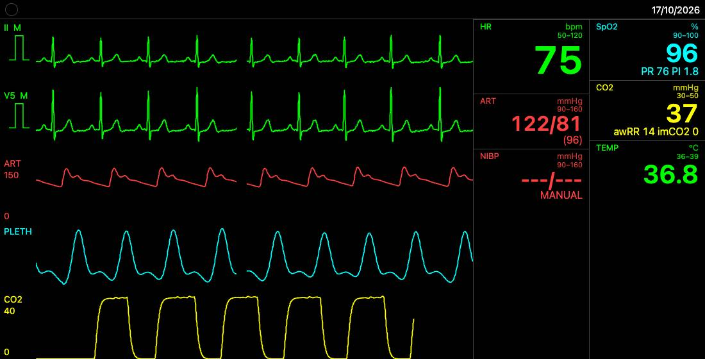
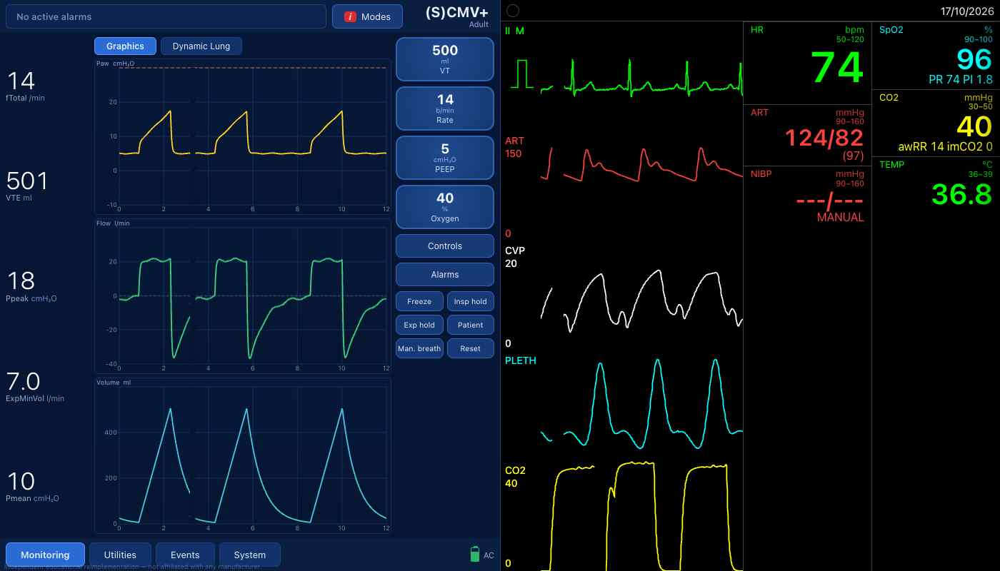

# patient-monitor-engine

An open-source (MIT) **simulated patient monitor** for web-based teaching simulators: ACLS/BLS, operating-room and
anaesthesia training, and the Hamilton-style ventilator simulator in this repository.

**Status: release candidate `1.0.0-rc.1` — a pre-release, not a final v1.0. For education only: not a medical device
and not clinically validated.** What remains before 1.0.0 and the plan for v2.0 are in the
[roadmap](docs/roadmap/README.md).



## What it is

- **A one-page clinical teaching app** (`apps/demo`, `index.html`): set up a patient, run the monitor, give drugs and
  fluids, explore the physiology and drive the ventilator view, from one page (Start, Monitor, Instructor, Explore
  physiology, Ventilator, Validate, Developer and Settings, plus Remote and the Debrief report). Time runs at up to ×8
  with a 2- or 5-minute fast-forward; a learner monitor can follow on a second screen in the same browser, or,
  read-only, on learners' phones over a classroom relay on the instructor's computer. The relay comes in the classroom kit, built from a source checkout
  with `node scripts/showcase/make-bundle.mjs` (Node.js ≥ 22; its double-click launchers are for macOS); it is not a
  release asset, and it has not yet been tested with a real phone at this release candidate. A static copy of the app
  on a web host, such as GitHub Pages, cannot pair phones. A Debrief report prints to PDF from the browser.

- **Channels:** ECG (3/5/12-lead), invasive pressures (ABP, CVP, PAP, and ICP where the organ model supplies it),
  NIBP with a real cuff cycle, SpO2 and pleth, EtCO2 and capnogram, temperature, respiratory rate.
- **Two physiology modes over one state:**
  - **MANUAL** — the instructor sets targets and ramps; fixed coupling rules keep the channels consistent.
  - **MODELED** — a lumped, teaching-grade physiology: four-chamber time-varying-elastance circulation, two-compartment
    lungs with gas exchange, blood chemistry, brain/kidney/liver, endocrine and thermal state, pharmacokinetics and
    pharmacodynamics of 65 drugs, a ventilatory drive and neuromuscular block. See
    [the physiology overview](docs/guides/physiology-overview.md) for what is modelled and what is not.
- **Device behaviour, not only waveforms:** numerics are *measured* (averaging, lags, probe states), NIBP cycles,
  IEC-style alarms with sound, pacer and defibrillator, 12-lead capture, trends and an event log.
- **Skins as data:** six monitor looks (`saadat-like`, `philips-like`, `zoll-like`, `ge-like`, `mindray-like`,
  `lifepak-like`) and two themes, validated JSON with a provenance for every value.
- **Control:** a same-screen instructor panel, a remote controller in another window of the same browser
  (BroadcastChannel), library transports for WebSocket (with a relay) and WebRTC (WebRTC is tested against a
  simulated peer connection and in Chromium only; a tablet remote over the network is an untested preview in the
  app), and a scenario runner for `pme-scenario/1` documents.
- **Embeddable:** ES modules, or **one file** — `patient-monitor.iife.js` works from `file://` with no server.

## What it is not

- **Not a medical device** and not for diagnosis, monitoring or treatment of real patients.
- **Not clinically validated.** The waveforms and the physiology have been *measured* against public recordings,
  published models and a reference physiology engine, and the misses found so far are listed in the
  [validation summary](docs/guides/validation-summary.md) and the [known deviations](docs/guides/known-deviations.md).
  The list is not yet complete: an evidence audit of the test targets found that many targets are themselves wrong
  and that some passing tests hide misses. The MODELED physiology is a teaching model whose calibration has not been
  done yet.
- **Adults only, and not complete.** Among the limits of this release candidate: there is no decompensation or
  reflex-collapse model; there is no sepsis model fit for teaching. The full list is in the [CHANGELOG](CHANGELOG.md) under "Known limitations".
- **Tested browsers:** desktop Chromium and WebKit by automated tests (Playwright); real Safari, phones and
  tablets only by hand checks that are still open at this release candidate; Firefox is not tested.
- **Not affiliated with any monitor manufacturer.** The `-like` skins evoke a general look; no logos or trade dress.
  Alarms are "IEC-style"; no IEC 60601-1-8 compliance is claimed.

## Quick start

**One file, from `file://`.** Download `patient-monitor.iife.js` from the
[latest release](https://github.com/samhv-dev/patient-monitor-engine/releases/latest), then:

```html
<div id="pm" style="height: 420px"></div>
<script src="patient-monitor.iife.js"></script>
<script>
  const pm = PatientMonitor.mountMonitor(document.getElementById('pm'), { skin: 'philips-like', engine: { seed: 7 } });
  pm.dispatch({ id: 'c1', issuedBy: 'page', type: 'setRhythm', rhythm: 'afib' });
</script>
```

**ES modules.** Build from source (below) and depend on the workspace packages; the packages are publishable
(`pnpm pack`) but are not on npm at this release candidate. See the [embedding guide](docs/guides/embedding.md).

**The ventilator with the monitor.** The release asset `ventilator-monitor-embed-v1.0.0-rc.1.zip` opens by double-click:
the Hamilton-style ventilator on the left drives the monitor's physiology on the right.



## Build from source

Node ≥ 22.12 and pnpm 9.15.9 (`corepack enable`, or prefix every command with `npx -y pnpm@9.15.9`).

```bash
pnpm install
pnpm typecheck && PME_TEST_SET=fast pnpm test && pnpm build   # the fast set; CONTRIBUTING.md has the slow one
pnpm --filter @pme/demo dev          # the clinical app (and the developer pages), http://localhost:5173
pnpm test:e2e                        # Playwright browser checks
pnpm docs:api                        # TypeDoc API reference → docs/api/
pnpm validate                        # the validation harness (30–60 min; downloads public datasets)
```

## Repository

| Path | What |
|---|---|
| `packages/engine-core` | the engine: rhythm engine, circulation, lungs and gas, blood, organs, drugs, device layer (no DOM) |
| `packages/renderer` | Canvas2D sweep renderer, numerics, `mountMonitor()`; builds `patient-monitor.iife.js` |
| `packages/audio` | QRS beep and alarm tones (Web Audio) |
| `packages/controller` | commands, transports, instructor panel, scenario runner, WebSocket relay |
| `packages/skins` | skins and themes as validated JSON |
| `packages/ventilator` | the ventilator simulation and its two-way link to the engine |
| `packages/validation` | the validation harness, blind-review tool and reports |
| `apps/demo` | demo pages, the ventilator embed and the Playwright tests |
| `docs/` | [design brief](docs/DESIGN-BRIEF.md), [build plan](docs/BUILD-PLAN.md), [guides](docs/guides/), stage plans and gate notes |

## Documentation

- [Embedding guide](docs/guides/embedding.md) — ESM and IIFE, options, commands, events, the ventilator example
- [Scenario authoring](docs/guides/scenario-authoring.md) — `pme-scenario/1`
- [Skin authoring](docs/guides/skin-authoring.md)
- [Physiology overview](docs/guides/physiology-overview.md) — what MANUAL and MODELED do, organ by organ
- [Validation summary](docs/guides/validation-summary.md) and [known deviations](docs/guides/known-deviations.md)
- API reference: `pnpm docs:api`, or `api-reference-<version>.zip` on each release
- [Roadmap](docs/roadmap/README.md) — what remains for 1.0.0 and the v2.0 plan

## Licence, data and citation

The code is [MIT](LICENSE) (© Ali Mahdavi and contributors). The engine bundles short ECG templates derived from
PhysioNet databases under ODC-By 1.0, and some modules are derived from Apache-2.0 sources; every third-party item and
its attribution is listed in [NOTICES.md](NOTICES.md), and the full third-party licence texts are in
[LICENSES/](LICENSES/); both travel with every build and release asset. Validation datasets are
downloaded, never committed. To cite this software, use [CITATION.cff](CITATION.cff).
Whether the attribution in NOTICES.md and the build banner is sufficient for ODC-By templates bundled in MIT-licensed
code has not yet had a legal review.

[Contributing](CONTRIBUTING.md) · [Security](SECURITY.md) · [Changelog](CHANGELOG.md)
