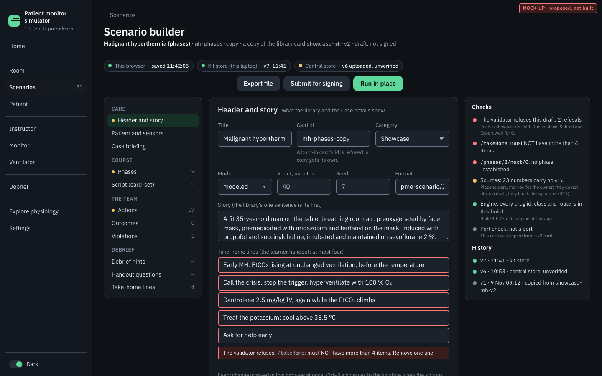
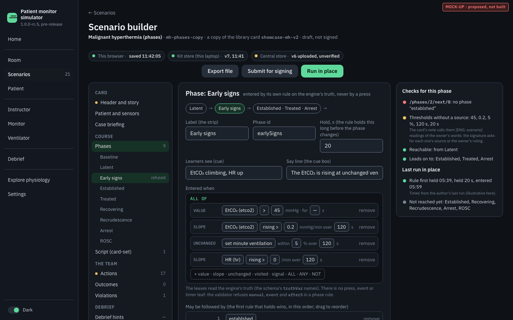
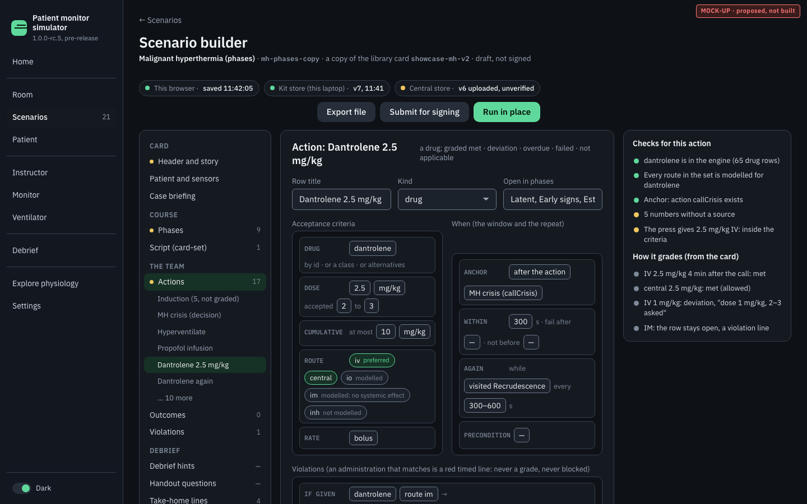
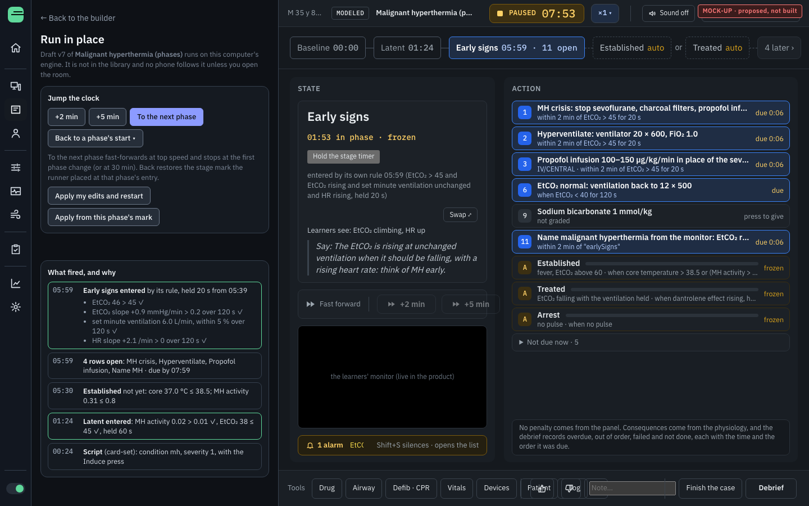
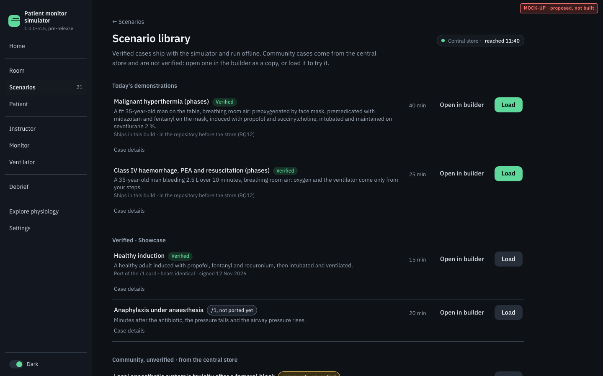
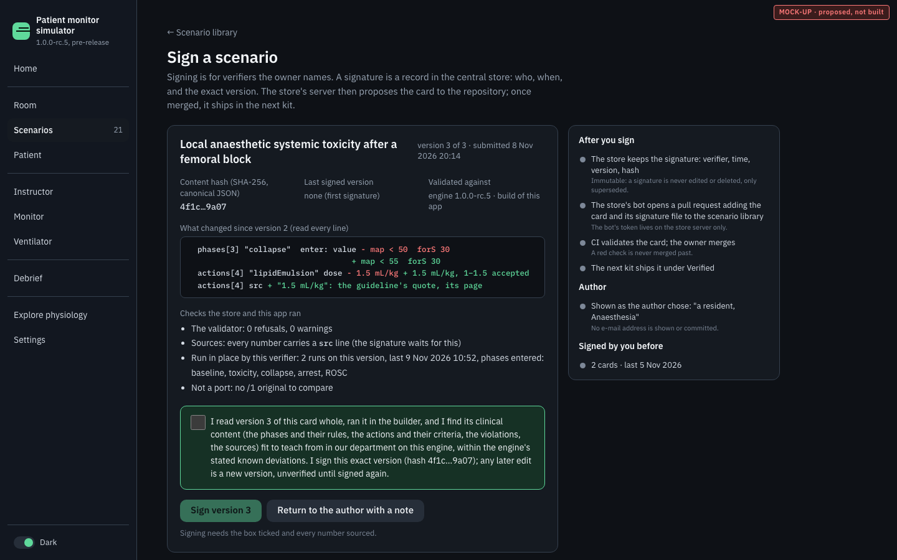

# The scenario builder and the scenario store: Implementation Plan

**STATUS: READY TO BUILD — the owner's fourteen rulings and his multimedia-library decision folded in (2026-11-09).
Nothing is built.** Written 9 November 2026 by a planning executor from brief 108 of the post-demo set; the owner
answered BQ1–BQ14 the same evening (now §14 "Decisions"), replaced the per-card attachments a card would have needed
with a curated multimedia library (BQ13.1, now §10), and brief 115 folded every ruling into the sections it touches. No
product code, test, card or engine file was changed. What still waits, named where it waits: **the concentration-signal
piece DC1 first** (BQ11: drug concentrations become phase-rule variables before the builder ships; it merges before
PR 1, §13); **the owner's Cloudflare sign-up test**, which decides which of the two store implementations of §9.2 is
built (B9a or B9b); and the owner naming a machine and an administrator, without which no central store is switched on
(BQ2). The builder, its local stores and the demo cards' sources (PR 0 to PR 6) wait for neither of the last two.

**Base and inputs.**
- Base: `origin/main` **8344539d** (Merge PR #359, `plan-learner-action-remote`), read in the worktree
  `scratch/wt-plan-builder` (branch `plan-scenario-builder`). Every `file:line` below is on 8344539d and is a starting
  point only: an executor finds the code by the function name given.
- Brief 115 merged `origin/main` **2c78c816** into the branch before folding the rulings; the `file:line` references
  below stay those of 8344539d (starting points only, as said).
- The owner's rulings this plan builds on, as the orchestrator's log records them: 8 November 22:28 ("Scenario builder:
  edits the current cards (answers row 51 too); runs the card in place against the engine; saves DURABLY, online,
  central database") and 9 November 03:55 (GitHub accounts are not acceptable for authors; the kit laptop is durable
  but not central; verification is a signing step; signed scenarios enter the GitHub repository and ship bundled with
  the simulator; unverified ones stay reachable through a cloud database), and his answers of 9 November 18:28–22:50 to
  the fourteen questions this plan asked (BQ1–BQ14, §14), with the multimedia library (BQ13.1, 22:29). The candidate
  collections for the library are the orchestrator's source note of that evening (its table is carried in §10.8).
- Read: `docs/plans/scenario-format-v2.md` (the `/2` design), `docs/plans/scenario-format-v2-plan.md` (its build, in
  particular F8's oracle O1–O4), `docs/guides/scenario-authoring.md` (the `/2` section), the stub in
  `apps/demo/src/app/views/scenarios.ts`, the schema `packages/controller/scenarios/pme-scenario-2.schema.json`, the
  validator `packages/controller/src/scenario/validate.ts`, the library `apps/demo/src/app/scenarios.ts`, Instructor v2
  (`apps/demo/src/app/teach2/`), the kit's servers (`scripts/showcase/server/launch.mjs`,
  `packages/controller/relay/server.ts`), and the Room plan's non-goal "Accounts, profiles, a scenario builder (owner,
  11:40: none until they exist)" (`docs/plans/room-and-instruments.md:114`). This plan is the "until they exist": it
  brings the first accounts the project has, for AUTHORS only, on a server the owner controls; learners still have none.
- The shape follows `docs/plans/debrief-2-option-c.md` (a plan whose mock-ups are in a folder beside it). The mock-ups
  are in `docs/plans/scenario-builder/mockup/`; its `README.txt` lists, for every page, what is the product's own and
  what is illustrative.

---

## 1. Intent

Today a scenario is a JSON file written by hand. `#/scenarios/builder` explains the `/1` format, offers "Import a
scenario file" and links the guide (`views/scenarios.ts:103–155`, "a visual builder comes later"). The owner wants
authors (residents, colleagues, himself) to write cases in the app:

1. **A builder** that is a form over `pme-scenario/2`: the phases and their entry rules, the actions with their
   acceptance criteria, the outcomes, the violations, the debrief hints and the handout questions, with the validator's
   refusals shown at the field that causes them.
2. **Run it in place**: the draft runs on this computer's engine, in Instructor v2 beside the builder, so the author sees
   a phase rule fire and an action's grade change, and can jump the clock.
3. **The current cards open in it**: every library card opens as a copy, which is how the remaining `/1` cards become
   `/2` (row 51 of the post-demo priorities), each proving that its course is unchanged.
4. **Nothing is lost, and cards are central**: an autosave in the browser at every change, the kit's own store on the
   department laptop, and a central store on a server the owner controls, where unverified cards are reachable by
   everyone who uses the app, and from which a verifier's signature sends a card into the repository so it ships with
   the simulator.
5. **A curated multimedia library** (the owner, BQ13.1): images such as a chest X-ray, a CT key image or an ECG strip,
   stored once, signed like cards, and referenced by cards, shown in the investigations view beside the lab results;
   heart and lung sounds follow in their own plan (§10).

## 2. Goals, non-goals, anti-goals

Goals
- One builder for both new cards and copies of existing ones; it writes only what the `/2` schema accepts.
- The validator that runs a card is the validator the builder shows: `validateScenario` (`validate.ts:78`), its errors
  keyed by JSON path, never a second rule set. Builder-only checks (missing sources, unreachable phases) are warnings
  and say so.
- A draft runs on the real engine through the real runner (`PhaseRunner`) and the real `grade()`; no preview engine.
- Three saving layers, each usable without the next: browser, kit, central.
- A signed card in the repository is byte-identical to the version signed (hash checked in CI).

Non-goals
- No change to the `/2` format beyond the two the owner ruled in, each in its own piece with its schema entries and
  validator rules: drug concentrations as phase-rule variables (DC1, BQ11) and references to media items (M2,
  BQ13.1). Any other gap the builder exposes (section 4.3) is listed with the piece that would close it; nothing is
  added to the schema to suit the builder.
- No physiology. A port that would need a mechanism the engine lacks says so and stops (the owner's rule: a fix is the
  mechanism, never a patch).
- No accounts for learners, no learner data, no debriefs or runs in the central store (section 9.7).
- The executor chooses no hosting provider and deploys nothing. Which of the two implementations is built follows the
  owner's Cloudflare sign-up test (§9.2); the central store is switched on only when the owner names a machine and an
  administrator, who deploys it from the repository's `services/store/` with its guide (BQ2 = C).
- No sounds in this plan: heart and lung sounds are engine-timed and get their own later plan (§10.7). No CT stack
  viewer in this plan's pieces (a later piece, §10.5).
- The relay on the store's server (row 42) is named as a later use of the same machine, not built here.

Anti-goals (a piece that does one of these is rejected)
- A builder control that produces a card the validator refuses, or a field the schema lacks.
- A phase entered by a press, a timer or a button in the builder (the `/2` rule: phases read the engine's truth).
- A secret in the deployed app: a token, an API key, a store administrator's password. The app holds only the
  signed-in author's own session token, in that browser.
- The store's bot pushing to `main`. It opens a pull request; CI validates; the owner merges (no push to main, and a red
  gate is never merged past).
- A port declared "identical" without the twin run of section 7.3.
- A guessed rule: a port's timed or probabilistic beat with no source becomes an instructor-pressed event, never a rule
  that only looks right (BQ9 = C).
- A verified card that references an unverified media item, or a media file in the code repository (§10).

## 3. Fixed points (the owner's rulings)

| # | Ruling | Where this plan honours it |
|---|---|---|
| F-1 | The builder edits the current cards; that answers row 51 | §7 |
| F-2 | The card runs in place against the engine | §6 |
| F-3 | Saving is durable and central | §8, §9 |
| F-4 | GitHub accounts are not acceptable for authors | §9.2: e-mail and password on the owner's store; nobody but the store's bot touches GitHub |
| F-5 | The kit laptop is durable but not central | §8: the kit store is layer 2, never the only copy that matters |
| F-6 | Verification is a signing step; signed cards enter the repository and ship bundled | §9.4, §9.5 |
| F-7 | Unverified cards stay reachable through a cloud database | §9.3: the "Unverified" shelf in the library (BQ14) |
| F-8 | Cards are `/2` only; Instructor v2 is the only instructor UI (5 November) | the builder writes `/2` only; run in place is Instructor v2 |
| F-9 | Judged rows are retired (5 November): a team act the instructor observes is a `record` action | §5.3: the builder has no judged-row editor; a `judged` block is refused with the validator's own line |
| F-10 | Every number carries its source; a number without one is a placeholder marked for the owner | §5.5: the sources check; signing waits for it (§9.4) |
| F-11 | The fourteen answers and the multimedia library of 9 November | §14, each row naming the sections it changed |

## 4. What exists today, and what the builder finds

### 4.1 The pieces the builder reuses (main 8344539d)

| Need | Already there |
|---|---|
| Validate a card | `validateScenario(input)` (`packages/controller/src/scenario/validate.ts:78`): the schema first (ajv), then `validateV2`'s cross-checks. Every error is one line `<json path>: <what is wrong>` (`validate.ts:36`), for example `/phases/2/next/0: no phase "x"`; a route the engine does not model is a WARNING with its path (`validate.ts:241`) |
| Run a `/2` card | `ScenarioDriver.load` picks `PhaseRunner` for a `/2` document; Instructor v2 (`#/teach2`) draws phases, rows and grades; `grade()` is pure (`grade.ts`) |
| Load a card that is not in the library | Instructor v2's "open a card file" (`teach2/begin.ts:70–81`) validates and keeps it in this browser through `keepImported` (`scenarios.ts:87`): per browser, under "Imported", a built-in id refused |
| Per-browser storage | `store.ts` (localStorage, wrapped: private windows throw) |
| Return to a phase | the runner places one stage mark per phase entry; Instructor v2's past chips restore it |
| Jump the clock | Fast forward +2 and +5 min (`fast-forward.ts:19`, `FF_SPANS`), disabled while paused |
| A durable folder on the kit laptop | the classroom relay keeps `room.json` in this computer's application-data folder (`launch.mjs:34`, `stateDir()`: `~/Library/Application Support/PME Classroom`, `%LOCALAPPDATA%\PME Classroom`), outside the kit folder, so it survives a kit update. **Superseded 10 November 2026** (§14, KS1): the kit's own `user-data` folder, inside the kit folder (B8) |
| An HTTP server in the kit | the relay serves the app and its own paths (`relay/server.ts:589`, `:627`); `serve.mjs` for the simulator alone |
| Persian through a table | one matcher (`i18n/fa-match.mjs`) over `docs/showcase/i18n/fa-debrief.json`, each entry `reviewed: false` until the owner reads it; `DRAFT_LINE` while any printed entry is unread (`i18n/fa-dom.ts`) |

### 4.2 The library today: 20 cards, 16 to port

`LIBRARY` (`scenarios.ts:57`) globs `apps/demo/src/app/showcase/*.json` and `packages/controller/scenarios/*.json`:
**20 cards**, 18 in `/1` and 2 in `/2` (`showcase-mh-v2`, `showcase-haemorrhage-v2`). Two of the `/1` cards are the demo
copies whose `/2` versions exist (`showcase-mh`, `showcase-haemorrhage`; F7.5 moves them out of the library). That leaves
**16 `/1` cards to port**: the eleven in `packages/controller/scenarios/` and five showcase cards (anaphylaxis,
bronchospasm, induction, induction after premedication, tamponade). Row 51 and the brief say "fourteen"; the tree holds
sixteen, listed in the census of §7.2. The plan covers all sixteen.

### 4.3 Findings while reading (each goes to the roadmap or a piece, none is fixed here)

1. **The stub's Import refuses `/2`, Instructor v2's accepts it.** `views/scenarios.ts:131` still says "importing a
   pme-scenario/2 card is not built yet", while `teach2/begin.ts` imports `/2` cards since brief 22. B2 replaces the stub;
   until then the message is stale.
2. **A phase rule cannot read a drug's concentration.** The schema's `truthVar` is the StateVars, `map`, `ph`,
   `lactate`, `mhActivity`, `mhExcess`, `dantroleneE` and `setMinuteVentilationLMin`. A local-anaesthetic toxicity card
   cannot enter "toxic" on a plasma level; it must use the effect (rhythm, QRS, MAP). **Decided (BQ11 = B, against
   this plan's default "later"):** the patient's plasma and effect-site concentrations become phase-rule variables
   BEFORE the builder ships, as the engine signal piece DC1 (§13), which the infusion-pump plan's TCI face shares
   (`docs/plans/pump-rack-tci.md`, E2 and the instructor's mirror of its §9): one piece serves both.
3. **The two `/2` demo cards carry no `src` on their actions.** Their numbers' provenance is in `$comment` prose. The
   sources check (§5.5) will mark them. **Decided (BQ12 = A):** a card merged by the owner counts as verified, and the
   two demo cards first get `src` lines for their numbers (piece V1, §13).
4. **Twelve of the sixteen `/1` cards use `afterS` and four use `probability`.** Neither exists in `/2` (a phase has no
   timer leaf; a phase change has no dice). Those beats cannot be translated mechanically (§7.2).
5. **Instructor v2 is crowded below about 1000 px.** Placed beside a 440-px builder at 1440 px, the dock's tools and
   marks overlap (mock-up 4). The split view needs Instructor v2's narrow layout or a collapsible builder (B6 decides,
   measured at 1280, 1440 and 1920 px).

## 5. The builder: a form over `/2`

Mock-ups 1–3 (`01-builder-main`, `02-phase-editor`, `03-action-editor`). Route `#/scenarios/builder` (the stub's),
with `#/scenarios/builder/<draftId>` for a draft. The page is a console page (the app's `console-page` styles), three
columns: the card's outline, the editor of one part, the checks.

### 5.1 The model under the form (B1)

- `formOf(doc)` and `docOf(form)` are pure and **lossless**: `docOf(formOf(doc))` deep-equals `doc` for every card in
  the library (20 today), key order included, `$comment` on every entry kept. The form never re-orders arrays the
  author did not touch, because `next` order and action order are meaningful.
- Each form field carries its JSON path. The validator's error paths map to fields by prefix (`/phases/2/next/0` →
  phase 3, its "may be followed by" list, row 1). An error whose path matches no field (a schema error on a whole
  block) shows at the block's heading.
- Validation runs on every change, debounced (300 ms), on the document the form would write: the author sees exactly
  what a load would see.

### 5.2 The sections (B2–B5), one per schema block

| Section | Schema | The editor |
|---|---|---|
| Header and story | `id`, `title`, `category`, `durationMin`, `seed`, `mode`, `story`, `takeHome` (≤ 4), `notes` | text fields; a copy's id must differ from every built-in id (`keepImported`'s rule) |
| Patient and sensors | `patient` (the `/1` block, by reference) | age, sex, weight, height, age band, sensors; the Patient page's own controls where they exist |
| Case briefing | `briefing` (`text` ≤ 4000, `estimatedMinutes`, `durationS` ≤ 600, `lang`, `textFa`) | text, with "never names the diagnosis" as the field's hint (the schema's own description) |
| Phases | `phases[]`: `id`, `label`, `cue`, `notes`, `initial`, `enter`, `holdS`, `next[]` | §5.3 |
| Script | `script[]`: `on` (`phase:<id>`, `action:<id>#n`, `atScenarioS`), `commands[]` | an anchor picker and the commands from the Drug, Airway, Defib · CPR and Devices sheets' own builders; labelled "card-set, never graded" |
| Actions | `actions[]` | §5.4 |
| Outcomes | `outcomes[]`: `id`, `text`, `rule`, `anchor`, `withinS` | a truth rule (the phase rule editor), an anchor, a window |
| Violations | `contraindications` on each action | edited in the action; listed together here |
| Debrief hints | `debriefHints`: `show` (≤ 4), `openers` (≤ 4, `at` + `text`) | an anchor picker limited to `start`, `pulseLoss`, `rosc`, `phase:<id>`, `action:<id>` of this card |
| Handout questions | `debriefHints.handoutQuestions` (≤ 3, `text` ≤ 92 characters) | the same anchors; a live count against the 92 (the measured A4 line, the schema's own note) |
| Media | `media[]` (M2, BQ13.1): an item's hash, a label, the anchor from which it is available | a picker over the library's items (§10.4), each shown with its record and its Verified or Unverified tag |

### 5.3 The phase editor (B3)

- The rule is a tree: ALL / ANY / NOT, and the five leaves `value` (var, op, value, `forS`), `slope` (var, op,
  `perMin`, `overS`), `unchanged` (var, `withinPct`, `overS` or `since: phaseStart`), `visited` (a phase of this card)
  and `signal` (`pulseLoss`, `rosc`, `rhythm:<id>` from the engine's rhythm table). The variable list is the schema's
  `truthVar` enum, with its units, and (from DC1) a drug's plasma or effect-site concentration, picked as a drug from
  the engine's rows that carry a concentration and shown in that row's own unit. There is no press, event or timer leaf
  to choose: the validator would refuse `manual`, `event` and `afterS`, so the builder does not offer them.
- `holdS`, `next` (a reorderable list of this card's phases: "the first rule that holds wins, in this order"), exactly
  one `initial` phase (no rule).
- A small flow line shows where the phase sits (predecessors → this → `next`), and an unreachable phase is a
  builder warning ("no phase leads to Recovering").
- The preview line is Instructor v2's own text for the rule ("when EtCO₂ > 45 and EtCO₂ rising and set minute
  ventilation unchanged and HR rising, held 20 s"), produced by the same function, `phaseRuleWords`
  (`card-read.ts:326`, used by `teach2/cue.ts:102` and the A rows), so the author reads what the instructor will.
- No judged rows: a recognition is a `communication` action (F-9). A pasted card with `judged` gets the validator's
  own refusal line naming the replacement.

### 5.4 The action editor (B4)

- `kind` decides the criteria block, as in the guide: `drug` → `drug`, `device` → `device`, `fluid` → `fluid`,
  `physical` → `physical`, `decision` → `effect`; `procedure`, `sample`, `communication` have none (matched by their own
  press or the `record` command).
- Drug criteria: identity by `id`, `cls` or `alternatives` (each with its dose), from the engine's `DRUGS` (65 rows) and
  its classes; dose (value, range, per kg), `cumulative.max`, route set and preferred route with each route's modelled
  state for that drug (`routeHonoured`, the validator's warning source), rate (`bolus`, `overS`, `infusion`).
- When: the window's anchor (every anchor of the guide's table: `start`, `phase:`, `action:`, `pulseLoss`, `rosc`, a
  truth `rule`, `each:action:`, a `display` rule, `first`), `withinS`, `notBeforeS`, `failAfterS`; `repeat` or
  `repeatWhile` (never both: the editor offers one); `precondition`.
- Violations: `contraindications` with `match` (kind, drug, class, route, dose), `inPhases`, `afterAction`, `when`,
  `harm: notModelled`.
- `give`: the commands a press sends, built with the Drug sheet's own form (so a press gives what a sheet would);
  a builder warning when the press would give something outside the action's own criteria ("the press gives 1 mg/kg;
  2–3 asked").
- `graded: false` (setup) and `preparation: true` (recorded, no verdict, no window) as two switches with the guide's
  words.
- A preview of the row as Instructor v2 draws it (title, subtitle, "due m:ss"), and the card's own grade examples
  computed by `grade()` on synthetic records (mock-up 3, "How it grades"): IV 2.5 mg/kg in the window met, IV 1 mg/kg a
  deviation, IM a violation with the row left open. In the product these lines are `grade()`'s own output; in the
  mock-up they were written for the page (its README says so).

### 5.5 The checks column

Three kinds, never mixed:
- **Refusals** (red): the validator's errors. While any stands, Run in place, Export and Submit wait. Each links to its
  field.
- **Warnings** (amber): the validator's warnings (route not modelled) and the builder's own: a number without `src`
  (F-10: "a placeholder, marked for the owner"), an unreachable phase, an action open in no reachable phase, a press that
  gives outside its criteria, a referenced media item not yet verified. Warnings never block a draft; the missing
  sources and an unverified item block a signature (§9.4).
- **Facts** (grey): the engine build the card was checked against, the last run in place (phases entered, times),
  the port check's result (§7.3).

## 6. Run it in place (B6)

Mock-up 4 (`04-run-in-place`). "Run in place" (enabled at 0 refusals) loads the draft into this computer's session as
a draft card (not in the library, not in "Recent", never on the wire as a library id) and shows Instructor v2 with the
builder's run panel beside it.

- **What fired, and why.** A log fed by the runner's own phase timeline and rule edges (`PhaseEntry`, `RuleEdge`, both
  already in the runner state): each phase entry with the rule that fired and, for each leaf, the value it read and
  its threshold; each action that opened, came due, was met or graded; each script entry. Values come from the samples
  the runner already keeps (the slope rings) and the engine's state at the edge, so nothing is recomputed in the page.
- **Jump the clock.** +2 and +5 min (today's), "To the next phase" (new: a fast-forward that stops at the first phase
  change or at 30 min, a stop condition in the host's fast-forward loop next to today's "stopped" reasons,
  `host-session.ts:836–869`), and "Back to a phase's start" (today's stage marks).
- **Apply edits.** The run does not change under the author's hands. "Apply my edits and restart" reloads the edited
  draft from 0; "Apply from this phase's mark" restores the mark of the current phase with the edited card (allowed only
  when the edit leaves the phase ids and the runner state's shape compatible; otherwise the button explains why and
  offers the restart).
- **Learners' devices.** A draft runs on the laptop. The room's phones follow only if the author opens the room, and
  then they see what they would see in class. The phone's Remote cannot load a draft (no draft id on the wire); an
  uploaded Unverified card is another matter (BQ3 = B, §9.3).
- **Layout.** Instructor v2 needs its narrow layout below about 1000 px (finding 5): B6 either collapses the builder to
  a strip while running or lays Instructor v2 out narrow, decided on screenshots at 1280, 1440 and 1920 px.

## 7. Editing the current cards, and the `/1` → `/2` port (B7)

### 7.1 Every card opens as a copy

"Open in builder" on any library card (mock-up 5) makes a copy: a new id (`<id>-copy`, editable), the original's id and
format kept in the draft's metadata (not in the card), and for a `/1` card, the converter's draft. A built-in card is
never edited in place in the app: the repository's copy changes only through a signed version (§9.5).

### 7.2 The converter: mechanical where the meaning is mechanical, flagged where it is not

The `/1` transition leaves and their `/2` form, following F8's step a (a faithful translation first, the owner's model
second):

| `/1` leaf | `/2` form | Mechanical? |
|---|---|---|
| `manual` (an instructor button) into state S | an action whose `give` is S's `onEnter`; S's other effects as `script` anchored on `action:<id>#1` (same stage group, O4) | yes |
| `event` (a learner act: drug, shock, ...) | an action matched by that event; the target state's `onEnter` as `script` on its taking | yes |
| `vital` (the measured value) | a phase rule on the TRUTH variable of the same name | the rule's rank changes (measured → truth): flagged, and the twin run measures the difference |
| `afterS` (time in a state) | none: a phase has no timer leaf | **no**: flagged; the porting executor proposes the truth rule the time stood for, with its sources, and the owner signs it (BQ9 = C; the time course comes from the mechanism); a beat no source can carry becomes an instructor-pressed event (an action whose `give` is the beat), never a guessed rule |
| `probability` / `else` | none | **no**: flagged; the same rule (BQ9 = C): a sourced truth rule signed by the owner, or the instructor presses the branch the case takes |
| `objectives` | actions (timed by their window) and outcomes | the objective's rule leaf decides; flagged when it reads a press |

Census of the sixteen cards (states, transitions, and the leaves by kind):

| Card | States | Transitions | manual | event | vital | afterS | probability | objectives |
|---|---|---|---|---|---|---|---|---|
| `acls-bradycardia-unstable` | 5 | 10 | 2 | 7 | 0 | 2 | 2 | 0 |
| `acls-pea-hypovolaemia` | 6 | 7 | 3 | 3 | 0 | 3 | 1 | 0 |
| `acls-vf-witnessed` | 5 | 10 | 5 | 4 | 1 | 3 | 2 | 0 |
| `depth-awareness` | 3 | 2 | 0 | 1 | 0 | 1 | 0 | 0 |
| `depth-light-anaesthesia` | 3 | 2 | 0 | 1 | 0 | 1 | 0 | 0 |
| `depth-opioid-apnoea` | 2 | 1 | 1 | 0 | 0 | 0 | 0 | 0 |
| `nmb-mh-trigger` | 2 | 1 | 1 | 0 | 0 | 0 | 0 | 0 |
| `nmb-residual-block` | 3 | 2 | 0 | 1 | 0 | 1 | 0 | 0 |
| `nmb-sux-burn` | 2 | 1 | 1 | 0 | 0 | 0 | 0 | 0 |
| `or-induction-hypotension` | 6 | 7 | 1 | 5 | 1 | 1 | 0 | 0 |
| `svt-adenosine` | 5 | 5 | 1 | 2 | 0 | 2 | 1 | 0 |
| `showcase-anaphylaxis` | 4 | 3 | 2 | 1 | 0 | 1 | 0 | 3 |
| `showcase-bronchospasm` | 3 | 2 | 1 | 1 | 0 | 0 | 0 | 3 |
| `showcase-induction` | 13 | 22 | 17 | 0 | 6 | 1 | 0 | 5 |
| `showcase-induction-premed` | 7 | 9 | 7 | 0 | 0 | 3 | 0 | 4 |
| `showcase-tamponade` | 15 | 25 | 22 | 0 | 3 | 0 | 0 | 5 |

(Counted by leaf occurrence in each card's `when`; an `any`/`all` may hold several. The eleven built-ins' objectives
live in `scenario-meta.ts`, not in the card.) Four cards are mechanical as they stand (`depth-opioid-apnoea`,
`nmb-mh-trigger`, `nmb-sux-burn`, `showcase-bronchospasm`); `showcase-tamponade` needs only the rank of its three
`vital` rules checked; the other eleven need a sourced truth rule or an instructor-pressed event for each `afterS` or
`probability` beat (BQ9 = C).

### 7.3 How a port proves its beats identical: the twin run

The F8 oracle (`scenario-format-v2-plan.md`, O1–O4), made general and run in CI for every port:

1. **Same presses.** The `/1` card is run unattended and with its run-sheet presses (or, for a card with no run sheet,
   one scripted path through every manual transition, recorded once on the port's parent commit), in the harness
   (`showcase/harness.ts` `runCard`), and the press times are recorded. The `/2` port is driven at the **same absolute
   times** through its action ids, through the driver as the panel does.
2. **O1 (i), the command stream.** The engine's received commands (type, payload, applied tick) of the two runs are
   diffed. Empty for every mechanical beat.
3. **O1 (i), the trace.** The 1 Hz engine trace of the two runs (state values, labs, signals) is diffed. The engine is
   deterministic with the card's seed, so a faithful port gives an empty diff, not a small one.
4. **O1 (ii), the phase-timing table.** Each `/2` phase entry against the `/1` state entry it replaces, every difference
   explained (a `vital` read on truth instead of the display, a `/1` hold counter reset at a hop). A difference is
   explained, never tuned away (no rule bent to match).
5. **O4.** A script entry anchored on a press fires in that press's stage group, tick for tick.
6. **The flagged beats** (`afterS`, `probability`, a rank change) are the only places the streams may differ. Each is
   listed in the port's PR with its measured shift, as "changed by design", with the source of each proposed truth rule
   or the note "no source: instructor-pressed", and the signature (§9.4) covers that list: the owner signs the
   differences, not a claim of identity (BQ9 = C).

The proof is a CI test (`ports.slow.test.ts`, one row per port in a manifest `apps/demo/src/app/showcase/ports.json`:
`/1` fixture, `/2` card, press path, the accepted beats), so it re-runs on every later engine change. The builder shows
the last result in its checks column ("Port check: command stream identical; trace identical; 2 beats changed by
design"), read from the manifest's last CI output, not computed in the page. The `/1` originals stay as test fixtures
(F7.5's frozen copies), never in the library.

Per card: about half a day (the owner's figure for row 51), more for the eleven with flagged beats. One card per pull
request (one piece of work per PR).

## 8. Saving in three layers (B2, B8, B10)

| Layer | Where | When | Survives | Shared with |
|---|---|---|---|---|
| 1. Autosave | this browser (IndexedDB through a wrapped store; localStorage's 5 MB and its throw in a private window are why not `store.ts` alone) | every change, debounced 300 ms; a local snapshot every 2 min of editing and at every Run, Export, Upload | a reload, a crash; NOT a cleared browser or another browser | nobody |
| 2. Kit store | the department laptop: the kit's OWN folder, `<kit folder>/user-data/` (visible, never a hidden place: the owner, 10 November, §14 KS1), `scenarios/<card id>/v0001-<UTC time>.json`, one card file per version | Ctrl+S, Export, Run in place (B6), and every 2 min of an open draft that changed while the kit runs on Node | a browser reset, a cleared browser, another browser of the laptop; NOT the laptop's loss, and NOT a new kit unless `user-data` is copied into it | everyone using that laptop's kit, and whoever is handed a copy of the kit folder with its `user-data` |
| 3. Central store | the store the owner switches on (§9) | "Upload", a press per card, with a required one-line change log; queued while the store is unreachable; never automatic (BQ5 = A) | the laptop's loss | every app that reaches the store |

- **Export and import as files** at every layer: a draft exports as its card JSON (`<id>.json`, the format a library
  card has, loadable by Instructor v2's open-a-file), and the kit store's whole folder exports as one archive. A file is
  always the way out when no store is reachable.
- **The kit store's rules** (amended 10 November 2026, §14 KS1; built in B8: `packages/controller/relay/store.ts`, the
  builder's `kit-store.ts`). The folder is `<kit folder>/user-data/` on every system, passed by every launcher (Start
  Classroom's relay and Start Simulator's Node.js server, `--state-dir`; `PME_STATE_DIR` overrides it for the kit's own
  tests); nothing is written to the computer's application-data folder any more. It is created at the first save and
  never shipped: the kit build has none (`check-relay.mjs` checks the fresh build). The relay keeps the last room code
  there too, in `.room.json`, a file that is itself hidden (a dot-file; on Windows also the hidden attribute); a code an
  older kit kept in the application-data folder is read once, and that file is left as it is. The PIN is never written.
  Writes come only from this computer: the loopback peer, a loopback `Host` and a loopback `Origin` or none (a phone on
  the room network, a page of another site open in the laptop's browser, a rebound name: all refused, 403); card reads
  are open to the room so another laptop window lists the drafts. A card's id is its folder's name only if it is a safe
  file name on every system (letters, digits, `_`, `.`, `-`; a letter or digit first; at most 64; no trailing dot; no
  Windows device name), so no path leaves the folder; a card file is at most 512 KiB (BQ13). A version is never
  overwritten: each is a file created only where no file was (a hard link from a hidden temporary file); the same bytes
  as the newest version write nothing. It stores card files only. The builder lists the cards the folder holds that this
  browser lacks and opens one at its newest version as a draft. The store line says in words where the work is kept ("in
  this browser and in this kit's user-data folder") or why it is not, and in each such case nothing is written anywhere
  else and it says to export a file: the kit was started without Node.js (ruby, perl or python, the launchers'
  fallbacks: they answer no `/pme-store/`, and the kit's `app/pme-kit.json` tells a kit from another site), the folder
  cannot be written (a read-only disk or a locked USB stick: the system's reason is named), the page is on another
  device, or the app is not running from a kit. Debriefs join the folder in `user-data/debriefs/` (brief 139, PR 2).
- **Two consequences the owner accepted with the ruling** (the kit's READ ME FIRST says both): a new kit starts EMPTY
  unless the `user-data` folder is copied into it from the old one; and a kit folder copied for a colleague carries its
  drafts (and, with PR 2, its debriefs) unless `user-data` is left out of the copy.
- The plan's "the kit store's whole folder exports as one archive" is not built: the folder is itself plain, visible
  files a person copies or backs up as they are.
- **Versions, not overwrites, under one card** (BQ13). Each layer keeps every version (a signature names an exact
  version, so none may be lost); a save never replaces the last version silently. What the author and the library see
  is ONE card with a version menu: each version with its number, date and change-log line; an older version opens from
  the menu (read-only, or as a copy). An upload to the central store requires the change-log line. Conflicts (the same
  draft changed in two places) keep both and show both in the menu.

## 9. The store: the project's first hosted service (B9–B12)

### 9.1 The constraint that decides where it runs, and when it is switched on

The department is in Iran. Several American cloud and software services refuse Iranian traffic under sanctions: in the
session that wrote this plan two design services' servers answered from here with HTTP 451 "Unavailable For Legal
Reasons". A store on such a service could be unreachable from the department, or closed without notice. So the store
is chosen by one test: **a browser on the department's network reaches it, and the store itself reaches the GitHub API**
(for publication, §9.5). The administrator checks both directions before the store is announced; the choice and its
date go into the store's guide.

**When (BQ2 = C, the owner, 18:45).** The builder and the local durable stores (layers 1 and 2, §8) ship first. The
central store's address is a Settings value the app reads (empty by default; no address and no credential is built into
the app). The central store is switched on when the owner names a machine (or a hosted account) and an administrator;
until then the builder's Upload and the Unverified shelf say "No central store is set" and everything else works. The
kit works with no store at all (§9.8), so a period without one costs central sharing, never teaching.

**The hosting survey of 9 November** (given to the owner in that conversation; not re-checked by this plan; NOT a
recommendation to deploy). Every option is a provider outside Iran whose sign-up rules for sanctioned countries only the
owner can test, and whose free terms change; the survey counted them all as US providers (Northflank is, to this
executor's knowledge, a UK company, which changes nothing: the test is his sign-up). Domestic providers are his to check.

| Option | What it is | Caveats as given on 9 November |
|---|---|---|
| Cloudflare Workers + D1 + R2 | serverless TypeScript, SQLite database, object storage | the first choice if the owner's sign-up works (§9.2 A); Cloudflare's own sign-up and payment rules for the region are the test |
| PocketHost | hosted PocketBase | one free project; the free instance hibernates when idle (slow first request, merge polling paused while it sleeps) |
| Oracle Cloud Always Free | a small Arm virtual machine | carries PocketBase easily, but cut in 2026 to 2 OCPU / 12 GB; out-of-capacity errors at creation; idle instances may be reclaimed (about 30 days idle); a payment card required |
| Google Cloud e2-micro (free tier) | a small virtual machine | 1 GB memory; US regions only; a billing account required |
| Northflank | container hosting | free tier limited to small services; terms to read at sign-up |
| Firebase Spark | Google's free back-end plan | no server code on the free plan, so the publication step cannot run there; the data model would be re-expressed in Firestore |
| Turso | hosted SQLite (libSQL) | a database only: accounts, rules and publication still need a compute host |
| Neon | hosted Postgres | a database only, as Turso |
| Render | web services and Postgres | free web services sleep when idle; the free database is time-limited |
| Appwrite Cloud | accounts, database, storage and functions as a service | a port of the data model and rules to its own; free-plan inactivity rules to read |
| Nhost | Postgres, GraphQL and accounts as a service | free projects pause when inactive; a port of the data model |

### 9.2 The software: one data model, two implementations, in order

The data model (§9.3), the rules, the trust model (§9.4) and the publication step (§9.5) are the same in both, and
`services/store/` carries a test suite written against the data model, so the second implementation can follow the
first without a new design. **The choice is pending the owner's sign-up test of Cloudflare** (BQ2; the question was
opened at 19:01): B9a is built if the sign-up works from the department, B9b otherwise. The executor of B9 does not
choose and signs up for nothing.

**A. Cloudflare Workers + D1 + R2 (first, if the owner's sign-up works).** A Worker written in TypeScript serves the
store's API; D1 (SQLite) holds the records of every collection; R2 holds the card documents and the media files, each
keyed by its `sha256`. Because the Worker is built from the repository's own modules, **the upload runs the project's
`validateScenario` and the sources-check module on the server**, which the draft's §9.4 said PocketBase hooks could
not do; a refused upload is refused with the validator's own line. Two constraints the piece states and tests: Workers
forbid code generation at run time (`eval`, `new Function`), which ajv uses to compile a schema, so the Worker carries
the schema compiled ahead of time by ajv's standalone mode, and a CI test shows it accepts and refuses exactly what the
app's validator does on every library card and every refusal fixture; and the Worker is built at a commit, so
`validatedWith` names that commit. The bot token is a Worker secret (environment, never the app or the repository); the
merge polling runs on a scheduled trigger; the administrator's console is the store's own role-gated page plus the
provider's dashboard; backups are D1's export and an R2 copy by the guide's script.

**B. PocketBase on a small machine, or on PocketHost (otherwise).** As the draft proposed: one binary (MIT licence),
SQLite, accounts, file storage, rules on each collection, server-side JavaScript hooks that can call an HTTP API, an
administrator's web console, and backups as files; one process and one data folder that a department can run and back
up, on a machine the administrator runs behind TLS, or on PocketHost (with its hibernation, §9.1). The hooks run an
embedded JavaScript engine without the app's modules, so the server checks the hash, the role, the two-person rule and
the sources (a port of the rule module, tested against the TypeScript module on the same fixtures), and refuses nothing
on the validator's account. The repository pins the PocketBase version it was tested with.

In both, **the validator of record is the repository's CI** on the publication's pull request (§9.5); in A the server's
run is an earlier refusal, not a replacement.

**Accounts (F-4, BQ4 = A, the owner, 19:01): invitation only.** The administrator creates an author's account and hands
the author a one-time link (by hand, through any channel the department already uses) to set the password; a password
reset is the same, a new one-time link. No outbound e-mail service (one more sanctioned dependency), no open sign-up.
The e-mail address is the sign-in name only.

### 9.3 The data model

| Collection | Fields | Rules |
|---|---|---|
| `authors` (accounts) | e-mail (sign-in only), password hash (the store's), `displayName` (the author's choice, may be empty, BQ7 = B), `role`: `author` / `verifier` / `admin`, `invite` (the one-time link's hash, expiry, used) | an author reads and edits only their own record; only an admin sets or withdraws `role` (BQ13: no per-author limit; the administrator may withdraw the author role); a verifier cannot sign with an empty `displayName` (BQ7: a signer shows a name) |
| `cards` | `slug` (the card id), `title`, `category`, `owner` → authors, `status`: `draft` / `shared` / `submitted` / `signed` / `merged` / `withdrawn`, `latest` → versions | anyone signed in lists `shared`, `submitted`, `signed`, `merged`; the owner of a card edits their own |
| `versions` | `card` → cards, `n` (1, 2, ...), `doc` (the card JSON as a file, at most 512 KB, text only, BQ13), `sha256` of its canonical JSON, `changeLog` (one line, required at upload, BQ13), `media` (the item hashes the document references, read from it on the server), `validatedWith` (app version and commit of the validator that ran: the author's, and in implementation A the server's), `createdBy`, `created` | append-only: a version is never edited or deleted (a signature names an exact version); a hook computes `sha256` on the server from the stored file |
| `media` (§10) | `sha256` (the item's id: the file is stored once), `kind`: `image` / `document` / `sound`, `mime`, `bytes`, `modality`, `region`, `finding` (one sentence), `captionEn`, `captionFa` (with `captionFaReviewed`, false until the owner reads it), `source` (URL or origin), `licence` (identifier and a link to its text), `credit`, `fetched` (date), `deidentified` (the uploader's attestation, burned-in text included: who, when, its words), `status`: `unverified` / `verified` / `withdrawn`, `recordSha256`, `uploadedBy`, `created` | the file is never replaced (its hash is its id); the record is editable by its uploader until signed; a signed record changes only through a new signature on the changed record (`recordSha256`) |
| `signatures` | `target`: a card version or a media item (its `recordSha256`), `sha256` (copied, must match), `signer` → authors (role verifier, a name shown), `assertion` (the text's version id), `created` | created only by a verifier; never on their own card or item once a second verifier exists (BQ1: the owner excepted until then); never updated, never deleted |
| `publications` | `signature` → signatures, `branch`, `pr` (URL), `state`: `queued` / `pr-open` / `merged` / `failed`, `log` | written by the server only |

**The Unverified shelf** (BQ14 = "Unverified", the owner's own word, for the shelf and for the header tag; mock-up 5)
= cards whose latest version is shared (`shared` or `submitted`) and not signed. The app lists each as ONE card with its
version menu (BQ13), the tag, and two buttons: "Open in builder" (a copy) and "Load" (to run it in the Instructor view).
**The room's phones may pick an Unverified card too** (BQ3 = B, the owner, 18:54): the same "Unverified" tag in the
phone's header as in the Instructor view's, and the same record line ("Unverified card <slug> v<n>, hash <first 8>,
loaded at <time> by <device>"). The phone's picker lists what the laptop lists; nothing on a phone talks to the store.
Verified cards keep their category groups (BQ8 = A), each card tagged "Verified".

### 9.4 The trust model and the signature

- **Who signs** (BQ1, the owner, 18:28). Verifiers: the owner and the people he names. The administrator sets the role;
  the role is not self-service. An administrator is not a verifier by being an administrator.
- **Two people per verified card.** A verifier never signs a card (or a media item) they wrote, the owner excepted
  until a second verifier exists; the store refuses a self-signature by anyone else, and the signature record of the
  owner's own card says "signed by its author while the sole verifier".
- **What a signature asserts** (mock-up 6; the owner accepted the draft's text as written on 9 November, so it is his
  text, `assertion` version 1): "I read version N of this card whole, ran it in the builder, and I find its clinical
  content (the phases and their rules, the actions and their criteria, the violations, the sources) fit to teach from in
  our department on this engine, within the engine's stated known deviations. I sign this exact version (hash H)." It
  does NOT assert that the engine's physiology is right (that is the validation gate's job), and it does not make the
  card a clinical guideline. A media item's signature asserts its record (source, licence, de-identification, finding)
  in the same form (§10.3).
- **What the server checks before it accepts a signature**: the signer's role is verifier and the signer shows a name;
  the two-person rule; the version is the card's latest; the `sha256` given equals the stored version's; the version's
  `src` lines cover every number (the sources check, from the same rule module the builder uses, B9); every media item
  the version references is verified; for a port, the twin run's accepted-beats list is attached; and in
  implementation A, the validator passes on the server (§9.2). **The validator of record is the repository's CI** on the
  publication's pull request (§9.5).
- **A card edited after signing** becomes version N+1, Unverified, shown in the card's version menu with "signed version
  N ships in the kit" beside it. The signed version stays the one in the repository until N+1 is signed; nothing in the
  repository changes when an author edits.
- **Withdrawal.** A verifier may withdraw a signature's effect only by signing a later version or by the owner removing
  the card from the repository through a normal pull request; the signature record stays (history is kept).

### 9.5 From a signature to the kit

1. The server creates a `publications` row and, with **a bot token the owner owns, kept in the server's environment and
   never in the app or the repository**, writes the card to a branch `store/<slug>-v<n>` and opens a pull request: the
   card at `packages/controller/scenarios/signed/<slug>.json` and its signature file `<slug>.signature.json` (`slug`,
   `version`, `sha256`, `changeLog`, `signedAt`, the signer's name as shown (BQ7), the assertion text's id, the store's
   version id, and the hashes of the media items it references; never an e-mail address), with any newly verified media
   records added to `packages/controller/scenarios/signed/media.json` (records only, never files, §10.6). The token is
   the narrowest GitHub offers: one repository, contents and pull requests (a fine-grained token or a GitHub App
   installation; the administrator's choice, in the guide).
2. CI runs as for any pull request; a new test (B12) checks that every card in `signed/` validates, that its canonical
   `sha256` equals its signature file's, that every media hash it references has a verified record in `media.json`, and
   (for a port) that its twin run is in the manifest and green.
3. **The owner merges, through the gate as today** (BQ6 = C, the owner, 21:42). A red check is never merged past. The
   automatic rule (merge when CI is green and the signature file's hash matches) is written by B12 as a later switch,
   its check implemented and its merge step off; switching it on is the owner's act, not an executor's.
4. The library's glob gains `signed/*.json`; a signed card shows "Verified" with the signature line, in its category
   group (mock-up 5). The next kit ships it, with its verified media items by hash (§10.6). The store's `publications`
   row turns `merged` when the server sees the pull request merged (polled; no webhook needs to reach the server).
5. **The cards already in the repository** (BQ12 = A, the owner, 22:07): a card merged by the owner counts as verified
   (the two `/2` demo cards and every port he merges); its signature file is written by his own sign step once the
   store exists. The two demo cards first get `src` lines for their numbers (V1, finding 3).

Why a pull request and not a commit to `main`: the project's rules (no push to main; one piece of work per PR; a red
gate is never merged past) apply to the bot as to every executor. The owner's ruling ("signed scenarios enter the
GitHub repository") is met at the merge, which follows the green run.

### 9.6 Security in short

- The deployed app (GitHub Pages and the kit) contains no credential and no built-in store address: the address is a
  Settings value (BQ2 = C). A signed-in author's session token lives in that browser's storage, as any web sign-in
  does, and "Sign out" removes it.
- The store allows cross-origin requests from the app's own origins only (the Pages address and the kit's loopback
  addresses); TLS only; the administrator's console on a separate path with its own password and, where the software
  offers it, a second factor.
- Rate limits on sign-in, on one-time links and on uploads. **A card document is at most 512 KB, text only** (BQ13; the
  largest library card today, `showcase-mh-v2.json`, is 34 KB): an image never travels inside a card, it is a media item
  (§10), whose own limits the server enforces.
- Backups: the store's data copied daily off the server (the guide's script); a restore is tested once before the store
  is announced.

### 9.7 Privacy: no learner data, ever

- The store holds authors (e-mail, optional display line, role), cards and their versions, media items and their
  records, signatures and publications. It holds **no learner's name, no run, no debrief, no record, no mark, no room
  code, no device**. A card is a teaching case, not a patient: the builder's hint on the story and briefing fields says
  "no real patient's identifying details".
- A media item is de-identified before it is uploaded and attested so by its uploader, burned-in text included;
  metadata is stripped on upload; DICOM files are refused (their headers carry identifiers); a verifier's signature
  covers the attestation (§10.2).
- An author's e-mail is never shown to other users and never written into a card, a signature file or the repository
  (BQ7 = B, the owner, 21:48). What other users see of an author is the display line the author chose, which may be
  nothing; a signer shows a name.
- The kit store holds cards only, on the department's laptop.

### 9.8 The offline path

The kit works with no store: the bundled library (verified cards and the verified media they reference) and the
builder's layers 1 and 2. When the store is unreachable, the library's Unverified shelf says "Central store not reached;
showing what this laptop has" with the time of the last successful read, Upload queues the version locally and sends it
when the store answers (BQ5 = A: a press per card; no automatic sync, which would send every draft of every author on a
shared laptop), and nothing else changes. A department with no internet at all writes, runs and exports cards; a card
reaches the central store when someone uploads its file from any connected browser.

### 9.9 The relay later (row 42)

The same server can later run the classroom relay as a hosted service (row 42, "who hosts and pays"), behind the same
TLS. That needs the relay's own security items (an instructor key, rate limits, Origin checks: row 42's list) and is not
part of this plan.

## 10. The multimedia library (BQ13.1, the owner, 22:29)

### 10.1 What it is, and what it replaces

The owner ruled that 512 KB is not enough for a case that carries a chest X-ray (22:15), and then, rather than
attachments per card, **a curated multimedia library** (22:29, all three proposals yes): images and sounds stored once,
each with its record, signed like cards, and referenced by the cards that use them. A card stays a text document of at
most 512 KB. One image used by five cards is stored once, verified once and shipped once.

### 10.2 An item

- **The file, stored once by its hash** (`sha256` of the stored bytes, after the metadata strip): the item's id. A
  changed file is a new item.
- **The record** (the `media` collection, §9.3): kind, modality and region, the finding in one sentence, captions in
  English and Persian (the Persian marked unreviewed until the owner reads it, as every Persian entry), source, licence,
  credit, the date fetched, and **the de-identification attestation**, burned-in text included.
- **Metadata stripped on upload.** The app removes the file's metadata before it is hashed and sent (EXIF and XMP in
  JPEG and WebP; text and EXIF chunks in PNG; the document information and XMP in PDF; INFO, ID3 and Vorbis comments in
  WAV and FLAC); the server checks again and refuses a file that still carries any.
- **DICOM is not accepted** (refused by its file signature, whatever its name): a de-identified display image is
  derived from it instead.
- **Formats and sizes** [ENG: ui; the owner's limits of 9 November, 22:29]: JPEG, PNG, WebP or PDF, at most 5 MB per
  image; WAV or FLAC, at most 2 MB per sound. The server sniffs the type from the bytes and refuses a file whose type
  and name disagree.

### 10.3 Trust: as cards

An item is **Unverified** until a verifier signs its record (the same roles and the same two-person rule as cards,
§9.4); the signature asserts that the verifier read the record, checked the source and the licence, looked at the
image for identifying marks, and finds the finding sentence true of the image. **A verified card references only
verified items**: the builder warns on an unverified reference, the store refuses to sign such a card, and CI refuses a
signed card whose referenced hash has no verified record (§9.5).

### 10.4 How a card references an item

The `/2` format gains one optional block (M2): `media[]`, each entry `{ ref: "sha256:<64 hex>", label, at }`, where
`label` is the line the investigations view shows ("Chest X-ray, supine AP") and `at` is the anchor from which the item
is available, from the card's own anchors (`start`, `phase:<id>`, `action:<id>`, as the debrief hints use them; a
radiograph that comes back after it is asked for anchors on the `sample` action that asks for it). The validator refuses
a malformed hash and an anchor the card does not have; it does not need the store (an item's presence and status are
the builder's warning, the store's check and CI's test). The builder's Media section picks items from the library with
their records shown.

### 10.5 Where an item shows

**Images open in the investigations view, beside the lab results**: where a `sample` action's results are shown today
(the `labs` event in the record). If no single investigations pane exists when M3 starts, M3 builds it as a sheet in
Instructor v2 and on the learner's view, and says so in its PR. A PDF opens in the same place. **The Debrief records
when**: "Chest X-ray (supine AP) opened at 06:12 on the instructor's laptop", from a record line written when the item
is opened. A scrollable CT stack is a later piece (M5, not sized here); until it exists a CT item is a key image.

### 10.6 Where the files live

**The code repository never holds the files.** The store keeps them (R2 in implementation A, PocketBase's file storage
in B). The repository keeps the verified records only (`packages/controller/scenarios/signed/media.json`: hash, record,
signature line). **Verified items travel in the release kit's assets, by hash**: the kit's build fetches every verified
item that a signed card references, checks each file's hash against its record, places it at `media/<sha256>.<ext>`,
and writes a credits file of every item's source, licence and credit. A licence with non-commercial or share-alike
terms travels with its item and in the credits file; it does not change the project's own licence. The GitHub Pages
build follows the same rule when its deploy can reach the store; when it cannot, the view shows the item's label and
caption with "image in the kit only" (M3 states which applies).

### 10.7 Sounds: engine-timed, their own later plan

Heart and lung sounds are **engine-timed**: the library provides the timbre (a recorded S1, S2, a murmur, a wheeze, a
crackle), and the engine places S1 and S2 on its own beats and the breath sounds on its own respiratory cycle, so a
sound follows the rate, the rhythm and the ventilation the learner is changing. That is its own later plan (not written
yet), referenced here and not designed here; until it exists the library accepts sound items (their record and their
signature) and no card plays them.

### 10.8 Candidate collections (the orchestrator's source note of 9 November)

Nothing here is verified against the collection's current licence page; the curator checks each item's terms at the
time of use and records them on the item.

| Collection | Content | Terms as noted |
|---|---|---|
| Wikimedia Commons | radiographs, CT key images, ECGs, some auscultation recordings | per file: CC0, CC BY, CC BY-SA, public domain |
| MedPix (US National Library of Medicine) | teaching cases with radiology images | free for educational use with attribution; each case's statement to check |
| Open-i (US National Library of Medicine) | images from open-access PubMed Central articles | the article's licence, often CC BY or CC BY-NC |
| Radiopaedia | radiology case library | CC BY-NC-SA 3.0; the terms travel with the item |
| LITFL ECG library | ECG strips with teaching text | CC BY-NC-SA |
| PhysioNet: CirCor DigiScope; the CinC 2016 heart-sound challenge | paediatric and adult heart sounds | Open Data Commons Attribution |
| ICBHI 2017 respiratory sound database | breath sounds, crackles, wheezes | research use; may not permit redistribution in a kit |
| The department's own de-identified films and recordings | any modality | the owner's attestation and the department's rules; the cleanest provenance |

## 11. Persian (B13)

**With the builder's final PR, once the strings settle** (BQ10 = A, the owner, 22:01); until the owner has read the
table, the department's authors read English chrome. The builder's chrome (labels, section titles, hints, the checks'
wording, the save chips, the version menu, the media picker, the sign step) goes through a table, as the Debrief's
does: a new `docs/showcase/i18n/fa-app.json` in the shape of `fa-debrief.json` (groups, strings, templates with
placeholders), read by THE matcher (`i18n/fa-match.mjs`), every entry `reviewed: false` until the owner reads it, the
draft line under the switch while any printed entry is unread. The Persian is written with the project's Persian rules
(formal register; displayed tokens such as `EtCO₂`, `mg/kg`, `Cp`, `Ce`, phase ids and JSON paths stay as written).
What the table does NOT translate: the card's own text (the author writes it in one language; the briefing's `textFa`
stays the one Persian field the format has), a media item's Persian caption (item data, on its record, §10.2), the
validator's paths, the engine's variable names. The validator's English message after the path is matched by the
table's templates where one exists, else printed in English and counted, as the Debrief does.

## 12. The mock-ups

Six static pages in `docs/plans/scenario-builder/mockup/`, built by `make-mockups.py`, captured by `capture.sh` at
1440 × 900. They link the app's own stylesheets (`apps/demo/src/app/app.css`, and for page 4 `teach2/teach2.css`,
`state.css`, `action.css`); the builder's new classes (`sb-*`, `mock.css`) use the app's tokens only. Page 4's right
half is Instructor v2's DOM as the app drew it for the MH card. `README.txt` lists what is real and what is
illustrative; every page carries the "MOCK-UP · proposed, not built" tag. **The pages were drawn before the owner's
rulings and were not re-rendered** (capturing needs a local web server, which this documentation pass did not start);
where a page draws words the rulings changed, its caption says so, and the words below are the product's.

**1. The builder's main screen**: the outline, the Header and story editor with an in-place refusal
(`/takeHome: must NOT have more than 4 items`), the checks with the refusals, the sources warning and the history. Its
save chip draws "v6 uploaded, unverified" in lower case; the product's tag is **Unverified**, and the history is the
card's version menu with each version's change-log line (BQ13).

**2. The phase editor**: Early signs of the MH card, its four leaves on truth, its hold, its `next` list with a planted
wrong id refused in place (`/phases/2/next/0: no phase "establshed"`), and the line Instructor v2 will draw. The
variable list it draws predates DC1; the product's list adds a drug's plasma and effect-site concentration.

**3. The action editor**: dantrolene with its acceptance criteria (identity, dose and range, cumulative, the route set
with each route's modelled state, rate), its window and conditional repeat, the IM violation, the press's `give`, the
sources field, the row's preview and `grade()`'s examples.

**4. Run in place**: the run panel (jump the clock, apply edits, "What fired, and why") beside Instructor v2 running the
draft. The dock's overlap at this width is finding 5, left visible on purpose.

**5. The library**: the demonstrations, Verified in its category groups (BQ8), a `/1` card not ported yet, the
unverified cards from the central store, and On this laptop. **The PNG draws the draft's words**: the shelf heading
"Community, unverified · from the central store", the tags "community, unverified", and a "draft v7" tag on the laptop's
copy. The product's shelf and tag read **Unverified** (BQ14), each card is one entry with a version menu (BQ13), and an
Unverified card's Load is offered on the room's phones too (BQ3).

**6. The sign step**: the version and its hash, the diff since the last version, the checks, the assertion to tick
(the owner's text since 9 November, BQ1), and what happens after
(the owner merges, BQ6).

## 13. Pieces, hours, dependencies, merge order, CI load

Hours are estimates for one executor, gates included; none is a measurement. Where a ruling changed a piece, the
change is named beside it.

| Piece | What | Depends on | Hours (est.) |
|---|---|---|---|
| **DC1** | **Drug concentrations as phase-rule truth variables** (BQ11 = B; shared with `docs/plans/pump-rack-tci.md`). The patient's true plasma and effect-site concentration of each drug the engine carries with a concentration (the `cp` and `ce` of `DrugPanelRow`, the 1 Hz `drugs` event, `pipeline.ts` near `:587`), delivered to the phase runner beside today's signals (`SIGNAL_VALUES` in `phase-runner.ts`); the schema's leaf `var` accepts `cp:<drugId>` and `ce:<drugId>` besides the `truthVar` enum, in the drug row's own unit; the validator refuses an unknown drug and a row whose unit is not a concentration (the gamma-curve rows midazolam, ketamine and dexmedetomidine until the pump plan's E3a–E3c give them a plasma compartment); `phaseRuleWords` reads it ("plasma propofol > N µg/mL", N the card's own sourced threshold); tests first: a rule on `cp:propofol` enters on the engine's own value, and the value is the PATIENT's, never a pump's prediction (the guard the pump plan's E2 keeps: its instructor mirror reads the same truth) | — | 10 (new) |
| B1 | `formOf`/`docOf`, lossless on all 20 library cards; path → field map; debounced validation | DC1 (merge order) | 8 |
| B2 | the builder route replacing the stub; Header, Patient, Briefing sections; layer 1 (IndexedDB, local snapshots, restore); refusals in place; export and import of a card file | B1 | 14 |
| B3 | the phase editor (rule tree, `holdS`, `next`, flow line, preview through `phaseRuleWords`), with DC1's concentration leaf | B2, DC1 | 13 (+1, BQ11) |
| B4 | the action editor (kinds, drug criteria from `DRUGS`, routes with `routeHonoured`, windows, repeats, precondition, violations, `give` from the sheets' forms, `grade()` examples) | B2 | 16 |
| B5 | Outcomes, Script, Debrief hints, Handout questions (92-character count), Take-home | B2 | 6 |
| B6 | Run in place: draft load, run panel, "What fired, and why" from the runner's timeline and edges, "To the next phase" (host fast-forward stop condition), apply edits, the split layout at 1280/1440/1920 | B3, B4 | 16 |
| B7 | the `/1` → `/2` converter with its flags (a timed or probabilistic beat flagged for a sourced truth rule or an instructor-pressed event, BQ9 = C); the twin-run test and `ports.json`; the builder's port-check line | B4, B6 | 16 |
| B8 | the kit store: relay paths for cards (loopback writes), `stateDir()/scenarios/`, layer 2 in the builder, folder export | B2 | 10 |
| B9a | `services/store/` on Cloudflare Workers + D1 + R2 (if the owner's sign-up works): the data model as D1 migrations, the rules in the Worker, invitation and one-time links (BQ4), hash and append-only, `validateScenario` with the ahead-compiled schema and its equality test, the sources check, the two-person rule and signer's name, publication with the bot token as a Worker secret, merge polling on a scheduled trigger, the deployment, backup and restore guide, the data-model test suite | B5 (the sources rule), the owner's sign-up test | 24 (draft's B9 18, +2 invitations, +4 the validator on the server) |
| B9b | the same on PocketBase (otherwise): collections as migrations, rules, hooks (the rule module's port tested against the TypeScript one), invitations, the guide for a small machine or PocketHost, the same test suite | B5, the owner's sign-up test | 20 (draft's B9 18, +2 invitations) |
| B10 | the app's store client: Settings address (empty by default), sign in and out, the one-time link page, upload with the required change-log line and the offline queue, the Unverified shelf with one card and its version menu, open as copy, conflicts; the Unverified tag and record line on the phone's picker and header (BQ3) | B2, B9a or B9b | 21 (+3 the version menu and change log, BQ13; +4 the phones, BQ3) |
| B11 | the sign step (verifier only): diff against the last version, the checks, the owner's assertion, the signer's name required, sign, publication status | B10 | 9 (+1, BQ7) |
| B12 | the signed library in the repository: `packages/controller/scenarios/signed/`, signature files, `media.json`, the glob, "Verified" in the category groups, the CI hash and media test; the later automatic-merge rule written with its merge step off (BQ6) | B9's file format | 8 (+2, BQ6 and the media records) |
| V1 | `src` lines for the numbers of the two `/2` demo cards (BQ12, finding 3), each from the provenance their `$comment` prose already names; their MH and haemorrhage table tests unchanged | — | 6 (new) |
| M1 | the store's `media` collection and its rules in the chosen implementation: storage by hash, the type sniff, the size limits, the metadata check, the DICOM refusal, the required attestation, item signatures under the two-person rule | B9a or B9b | 12 (new) |
| M2 | the `/2` format's `media[]` block (schema, validator, `types-v2.ts`), the builder's Media section and picker, the unverified-item warning, the sign step's refusal and B12's CI test of referenced hashes | B5, M1 | 10 (new) |
| M3 | the investigations view with images and PDFs beside the lab results, in Instructor v2 and the learner's view; the "opened at" record line and its Debrief line; the kit's build fetching verified items by hash with the credits file; the Pages rule (§10.6) | M2, B12 | 16 (new) |
| M4 | the curator's page in the app: upload with the metadata strip in the browser, the record form (captions in both languages, source, licence, attestation), the item's version of the sign step | M1, B11 | 12 (new) |
| B13 | Persian: `fa-app.json` with the builder's strings (version menu and media picker included), `reviewed: false`; the switch and the draft line in the builder | B6, B11, M4 (strings settled) | 6 (+1), plus the owner's reading |
| B14 | docs (the authoring guide's "Using the builder", the store's administration guide with the hosting choice and its date, the media curation guide, the privacy statement), the builder e2e (Chromium and WebKit) | all | 8 (+2) |
| **Total** | with B9a; with B9b instead, 4 h less | | **241** (draft: 155) |
| Ports | one PR per `/1` card, sixteen (§7.2), each with its twin run green, its changed beats listed with their sources or "instructor-pressed", signed by the owner (BQ9) | B7 | about 4 each, more for the eleven with flagged beats: 64 or more, plus the owner's signing |
| Later, not sized | M5 the CT stack viewer (§10.5); the engine-timed heart and lung sounds, their own plan (§10.7) | M3 | — |

The total's growth from the draft's 155 h: DC1 10, V1 6, the multimedia library M1–M4 50, and the rulings' additions
to existing pieces 20 (B3 +1, B9 +6 as B9a, B10 +7, B11 +1, B12 +2, B13 +1, B14 +2).

Pull requests (one piece of work each, in merge order):
0. **PR 0, DC1**: drug concentrations as phase-rule variables (10 h), engine and controller, engine-classified slow
   groups; no physiology changes, so no validation row moves (any that does is a finding). **First on the critical
   path** (BQ11: before the builder ships), and shared: the pump plan's E2 and its instructor mirror read the same truth.
1. **PR 1, B1 + B2**: the builder's foundation and layer 1 (22 h). Replaces the stub; finding 1 goes with it.
2. **PR 2, B3 + B4 + B5**: the editors (35 h). Could split into three PRs if review asks; they touch separate files.
3. **PR 3, B6**: run in place (16 h). After it, an author builds and runs a card in the kit with no store: **the
   critical path to a usable builder is PR 0 → PR 1 → PR 2 → PR 3, 10 + 22 + 35 + 16 = 83 h** (the draft's 72 h, plus
   DC1's 10 h and B3's 1 h).
4. **PR 4, B7**: the converter and the twin run (16 h). Then the sixteen port PRs, one card each, in any order, the four
   mechanical cards first.
5. **PR 5, B8**: the kit store (10 h). May go any time after PR 1.
6. **PR 6, V1**: the demo cards' `src` lines (6 h). Any time; before their signature files are written.
7. **PR 7, B9a (or B9b) + B12**: the store's code and the signed library format (32 h, or 28 h with B9b), once the
   owner's sign-up test has chosen the implementation; B9's sources module merges after B5's rule exists.
8. **PR 8, B10 + B11**: the app's client and the sign step (30 h), after PR 7. Its e2e signs in against a local store
   started by the test (implementation A: the Workers runtime run locally, pinned by the lockfile; B: the PocketBase
   binary pinned and checked by hash). It needs no deployed store.
9. **PR 9, M1 + M2**: the media items in the store and their references in cards (22 h), after PR 7 and PR 2.
10. **PR 10, M3 + M4**: the investigations view, the kit's media assets and the curator's page (28 h), after PR 9 and
    PR 8.
11. **PR 11, B13 + B14**: Persian and the docs (14 h), last (BQ10: Persian with the builder's final PR).

The central store is switched on after PR 8 at the earliest, and only when the owner has named a machine and an
administrator (BQ2); no PR waits for that.

CI load: twelve PRs plus sixteen port PRs; every PR runs the whole `ci.yml` (it touches code), one run per head; PR 0 is
engine-classified (the slow groups); PR 4 and every port PR add the `test-slow` showcase group with the twin runs
(about the length of today's MH table test per card). PR 8's e2e starts a local store: for B, the CI image needs the
PocketBase binary pinned and checked by hash (a download in CI, the same policy as Playwright's browsers); for A, the
local Workers runtime comes through the lockfile. PR 10's kit build fetches no media in CI (a fixture item stands in).
This docs PR runs only the `docs` job.

## 14. Decisions (the owner, 9 November)

The owner answered the fourteen questions of the draft on 9 November 2026, between 18:28 and 22:50, and in the same
conversation replaced per-card attachments with a curated multimedia library (BQ13.1). The source is
`research/00-orchestrator-rulings.md`, the entries of 9 November from 18:28 onward (search "BQ"). The question each
ruling answers is the draft's §13 (git history of this file, commit a03b2e27). No question of this plan is open; what
waits is named in the status line.

| ID | Question | Ruling | Ledger | Applied in |
|---|---|---|---|---|
| **BQ1** | Who may sign? | The owner and the people he names (the administrator sets the role); two people per verified card, the owner excepted until a second verifier exists; the §9.4 assertion text accepted as drafted (now his text) | 18:28 | §9.3, §9.4, B11, mock-up 6 |
| **BQ2** | Where does the server run, and who administers it? | **C**: the builder and the local durable store ship first; the central store's address is a setting the app reads; the server is switched on when he names a machine and an administrator. Two implementations in order: Cloudflare Workers + D1 + R2 first if his sign-up works, PocketBase on a small machine or PocketHost otherwise; the choice pending his sign-up test | 18:45 (Cloudflare asked 19:01) | status, §2, §9.1, §9.2, §9.6, B9a, B9b, §13 |
| **BQ3** | May the room's phones pick an unverified card? | **B**: yes, with the same "Unverified" tag in the phone's header and the same record line | 18:54 | §6, §9.3, B10, mock-up 5 |
| **BQ4** | Who creates author accounts; is e-mail sent? | **A**: invitation only; the administrator creates accounts and hands one-time links; resets the same way; no outbound e-mail | 19:01 | §9.2, §9.3, B9a, B9b, B10 |
| **BQ5** | Does the local store sync automatically? | **A**: upload is a press per card, queued while the store is unreachable; no automatic sync | 21:14 | §8, §9.8, B10 |
| **BQ6** | Who merges a publication's pull request? | **C**: the owner, through the gate as today; the automatic rule (CI green and the signature hash matches) written as a later switch, not enabled | 21:42 | §9.5, B12 |
| **BQ7** | What shows of an author? | **B**: an author's display line is their choice, including nothing; a signer must show a name; e-mail never shows and never enters the repository | 21:48 | §9.3, §9.5, §9.7, B11 |
| **BQ8** | The verified section's order | **A**: verified cards keep their category groups | 21:57 | §9.3, §9.5, B12, mock-up 5 |
| **BQ9** | A port's changed beats | **C**: a timed or probabilistic beat becomes a truth rule proposed by the porting executor with sources and signed by the owner; a beat that cannot be sourced becomes an instructor-pressed event, never a guessed rule | 21:59 | §2, §7.2, §7.3, B7, ports |
| **BQ10** | Persian for the builder now or later? | **A**: with the builder's final PR, once the strings settle | 22:01 | §11, B13, PR 11 |
| **BQ11** | A drug concentration as a phase-rule variable | **B**: plasma and effect-site concentrations become phase-rule variables BEFORE the builder ships, as an engine signal piece shared with the pump plan's TCI face | 22:04 | status, §2, §4.3, §5.3, DC1, PR 0, `pump-rack-tci.md` E2 |
| **BQ12** | The cards already in the repository | **A**: a card merged by the owner counts as verified; signature files written by his own sign step once the store exists; the two `/2` demo cards get `src` lines first | 22:07 | §4.3, §9.5, V1 |
| **BQ13** | Limits | a card document ≤ 512 KB, text only; versions kept in the data (signatures need exact versions) but ONE card with a version menu, a required one-line change log per upload, older versions openable from the menu; no per-author limit, the administrator may withdraw the role | 22:15 | §8, §9.3, §9.6, B10 |
| **BQ13.1** | (raised by the owner) Images and sounds on a card | a curated multimedia library replaces per-card attachments: items stored once by hash with a record, metadata stripped, DICOM refused, Unverified until signed, verified cards reference only verified items; JPEG/PNG/WebP/PDF ≤ 5 MB, WAV/FLAC ≤ 2 MB; images in the investigations view, the Debrief records when; files never in the repository, verified items in the kit by hash; sounds engine-timed in their own later plan; a CT stack later | 22:22–22:29 | §1, §2, §9.3, §9.7, §10, M1–M4 |
| **BQ14** | The unverified shelf's name | **"Unverified"**, the owner's own word, for the shelf and the header tag | 22:50 | §3, §9.3, §9.8, mock-ups 1 and 5 |

**10 November 2026, the kit store (KS1, the owner; brief 139).** "I do not want anything written into a hidden folder"; "I
prefer option A for now until we have something central and durable"; "make sure the file holding the codes is hidden
itself". The app does not ask the browser for persistent storage (N40 = B); everything worth keeping is written to a
data folder on disk, and that folder is INSIDE the kit folder, `user-data/`, visible: scenario cards with their
versions (B8, brief 139 PR 1) and debriefs (PR 2). The last room code moves there from the computer's hidden
application-data folder, in a file that is itself hidden (`.room.json`). Its two consequences: **a new kit starts empty
unless the `user-data` folder is copied into it**, and **a kit folder shared with a colleague carries its debriefs and
drafts unless that folder is left out**. Applied in §4.1 (superseded row), §8 (layer 2's row and rules) and B8.

**Where a ruling changed a decision of the draft** (each resolved in favour of the ruling):
1. BQ11 = B against the draft's default ("later, its own piece") and its non-goal "no change to the `/2` format": DC1
   comes first on the critical path, and the non-goal is narrowed to the two format additions the owner ruled in (DC1's
   concentration variables, M2's media references).
2. BQ2 = C against the draft's §9.1–§9.2 ("self-hosted on a virtual private server ... names no provider"; PocketBase
   proposed): Cloudflare Workers + D1 + R2 is the first implementation if the owner's sign-up works, PocketBase the
   second; the reachability test stays the deciding test. With Workers the store runs the project's validator at upload,
   which the draft's §9.4 said the server could not; CI stays the validator of record.
3. BQ3 = B against the draft's default ("a phone's Remote cannot pick one"): the room's phones may pick an Unverified
   card, tagged.
4. BQ9 = C against the draft's §7.2 alternatives (a card-set `script` at a scenario time for a timer; "the branch the card
   teaches or a seeded engine mechanism" for a die): those alternatives are dropped; a beat is a sourced truth rule the
   owner signs or an instructor-pressed event.
5. BQ13 against the draft's per-version listing (the library showed a card's versions as separate entries): one card
   with a version menu and a required change log.
6. BQ13.1 against the draft's card-only store: a fifth collection (`media`), a new section (§10) and four pieces
   (M1–M4); the card's 512 KB limit stays, text only.
7. BQ14 against the draft's "Community, unverified": "Unverified". The mock-up PNGs keep the draft's words (§12).
BQ1, BQ4, BQ5, BQ6, BQ7, BQ8, BQ10 and BQ12 chose the draft's defaults (BQ6 and BQ7 with the precision the owner added:
the automatic rule written but off; a signer must show a name), now decisions.

## 15. Risks

- **The store is the project's first service.** It has an uptime, backups, a bot token that can open pull requests,
  and accounts. If nobody administers it, it is worse than none. Mitigation: nothing is switched on before the owner
  names the machine and the administrator (BQ2); the kit never depends on it.
- **Reachability can change.** A provider reachable today may be blocked later from either side, and a US provider may
  close an account from a sanctioned country without notice. Mitigation: the offline path (§9.8), file export at every
  layer, the data-model test suite that lets the second implementation follow the first, and the guide's backups.
- **Media can carry a patient's identity.** A radiograph's burned-in name, a file's metadata. Mitigation: the strip in
  the browser and the server's check, the DICOM refusal, the uploader's attestation, and a verifier's signature before
  any item reaches a verified card or the kit (§10.2, §10.3).
- **Licences travel with items.** NC and SA terms. Mitigation: the licence on every record, the kit's credits file, and
  the curator's check at the time of use (§10.6, §10.8).
- **Ports that are not mechanical take the owner's time.** Eleven of sixteen need a truth rule in place of a timer or a
  die, each a small clinical decision with a source that he signs, or an instructor-pressed event (BQ9 = C). Mitigation:
  the four mechanical cards first; the rest one per PR.
- **A signature can be read as more than it says.** Mitigation: the assertion's words (§9.4), the known-deviations link
  on every verified card's details, and "Verified" meaning "read and run by a named verifier on this engine", nothing
  more.
