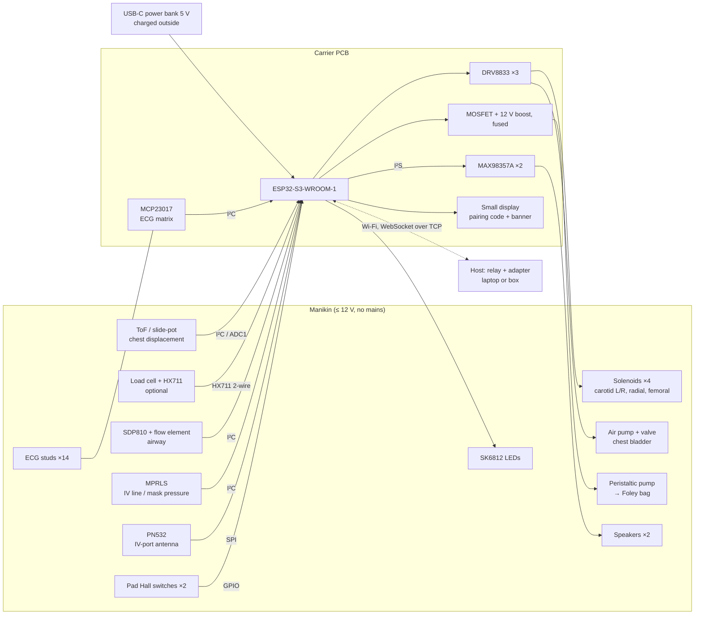

# Manikin bridge: a basic CPR manikin as a device client of the engine (design note for a later release)

> **Status: design note only.** No hardware is built, nothing is deployed or configured, and no code changes. **None
> of it is in 1.0.0-rc.1 or 1.0.0-rc.2.** The note answers the owner's request (E74): turn a simple CPR manikin into a
> high-fidelity one that sends what the learners do (CPR quality, drugs injected, where the ECG leads are) and shows
> what the patient does (pulses, breathing, urine output, a wrong ECG when the leads are wrong).
>
> Written 2026-10-19 against `origin/main` f4f479d9 (after #84). File:line references are to that commit.
> - The bridge is built to fit the role model and protocol of the headless-host design note
>   (`docs/roadmap/v2.0/evidence/headless-host-design.md`, PR #85, open, merges after the rc.2 tag). Section numbers
>   "#85 §x" point there.
> - References to `research/00`, `research/33` and `research/36`, and to owner questions (E-numbers), point to the
>   project's working notes, which are kept outside this repository.
> - Every hardware, part, price or standards claim carries a URL and the date it was read. Every hour figure and every
>   price total is an **ESTIMATE**. Every number marked [ENG] is an engineering choice, not a measurement and not a
>   clinical source.
> - **For education only. Not a medical device.** That rule binds every line below, the hardware included (§1).

---

## 0. One page

**The request** (research/36 §1, §4): "transform a simple CPR manikin to a high-fidelity manikin which can receive
different data and info, like CPR quality or drugs injected or show urine output or wrong ECG in case chest leads
connected incorrectly."

**The shape.** A small board, the **bridge**, sits inside or beside a basic adult CPR manikin.
- It is built on an ESP32-S3 Wi-Fi module on a 2-layer carrier PCB, powered from a 5 V USB-C power bank.
- It joins the session over WebSocket as a `device` client (#85 §2.4), paired by a per-device code (E81).
- It **sends** what it senses: compressions, ventilations, which ECG lead clip sits on which skin stud, and tagged
  syringes pushed at the IV port.
- It **receives** a cue stream: pulse taps, chest rise, urine to pump, body sounds.
- The bridge runs no engine. A **device adapter** inside the host turns its inputs into ordinary engine commands, and
  engine state into cues.

**What the engine already has, and what it lacks** (evidence in §2, §3):

| Feature | Engine today | What the bridge needs |
|---|---|---|
| CPR on/off, rate | **exists**: `applyEvent {kind:'cpr', active, rate, quality}` (`packages/engine-core/src/types-hemo.ts:25`) | an adapter maps measured rate and depth onto it |
| CPR depth, recoil, hands-off | **partial / missing**: one scalar `quality`, a fixed recoil residual, no pause tracker | adapter mapping now; recoil input and a CPR record later (model items M1, M2) |
| Bag ventilation volume | **partial**: `bvm` is a fixed rr/vt setting; a per-sample `externalDrive` path exists | adapter synthesises frames host-side (M3 for logging) |
| Lead placement | **missing**: one global `leadOff`; no reversal | an electrode-to-lead remap after the VCG projection (M4) |
| Drug push | **exists**: `applyEvent {kind:'drug', …}` | tags carry the dose; adapter validates |
| Pulses, breathing, urine | **exists** as engine state (beat, breath, kidney `bagMl`) | cue stream; breath onset needs M5 |
| Heart and lung sounds | **missing** (grep: no model) | a sound model (M6) before speakers mean anything |
| Defibrillation | shock is an instructor or instrument command | **sense-only**; never real energy (§1) |

**Bill of materials** (§4.4): about **USD 160** for the phase (b) bench kit on development boards, and about
**USD 430** for one full bridge on its carrier PCB. The full bridge splits into ≈ USD 260 of parts priced from vendor
pages and ≈ USD 170 of items I estimated. Both totals are ESTIMATES, single-unit prices, excluding shipping, tax and the
manikin. A Little Anne QCPR costs about USD 320 (§4.4).

**Phases** (§6; hours are ESTIMATES excluding independent review):

| Phase | What | Hours (ESTIMATE) |
|---|---|---|
| (a) | engine side: device role use, adapter, ECG remap, cue stream, bridge simulator for CI | **47–75** |
| (b) | bench prototype on dev boards: CPR plate, ECG lead IDs, pulse taps | **50–78** |
| (c) | drug tags, urine pump, chest rise, sound model and playback | **44–70** |
| (d) | carrier PCB in KiCad, bring-up, enclosure | **34–56**, plus 20–40 h of a hardware engineer |
| (e) | Debrief CPR-quality section (research/33 Option C) | **16–26** |
| | **total** | **191–305**, plus the hardware engineer |

Phase (a) needs #85's role and command-set mechanism (its step 2). It does **not** need the headless host (#85 step
1): the adapter can run in today's browser host, and the bridge then works with the laptop over the relay (E91).

**Owner questions E87–E93** (§7): the manikin to start from, the first three features, the drug method, defibrillation
handling, working without the appliance, pairing a device that has no screen, and who wins when the manikin and the
instructor both set CPR.

---

## 1. Scope and safety rules

These rules are part of the design, not advice. A phase that cannot meet one does not ship.

1. **Low voltage only: ≤ 12 V anywhere inside the manikin; no mains inside it.**
   - The bridge runs from a 5 V USB-C power bank. The bank is charged outside the manikin, from its own charger, and
     the manikin carries no charger and no mains lead.
   - The only rail above 5 V is a local 12 V boost for the peristaltic urine pump (§4.3). It is fused and drives
     nothing else.
   - The EU Low Voltage Directive covers 50–1000 V AC and 75–1500 V DC, rated at a product's input or output, and a
     product's charger can bring it into scope ([LVD summary](https://en.wikipedia.org/wiki/Low_Voltage_Directive);
     [Element, Commission LVD guide](https://www.element.com/resources/articles/the-european-commissions-guide-to-the-low-voltage-directive);
     both read 2026-10-19; secondary sources). A 5 V bridge is below that range; the power bank's charger is the
     LVD item, and it is a bought, certified product.
   - **Low voltage does not exempt a radio product from safety.** The Radio Equipment Directive applies the LVD's
     safety objectives "with no voltage limit applying" (RED 2014/53/EU Art. 3(1)(a),
     [EUR-Lex](https://eur-lex.europa.eu/legal-content/EN/TXT/?uri=CELEX:32014L0053), read 2026-10-19). Anyone who
     sells or distributes a built bridge must therefore make a safety assessment for it, typically against
     EN 62368-1 (not researched here). An open design published as files is not that product. The note says so in the
     README of the hardware folder.
   - **No Li-ion pack on the carrier.** A bought power bank keeps cell safety (IEC 62133-2,
     [EVS listing](https://www.evs.ee/en/iec-62133-2-2017), read 2026-10-19) with its maker. Caveat: some banks switch
     off below about 50–200 mA ([Hackster on GreatScott](https://hackster.io/news/greatscott-offers-low-cost-solutions-to-a-big-usb-power-bank-problem-low-current-shut-off-f98143bec9e4),
     read 2026-10-19, search summary). The bridge never deep-sleeps while paired, so this matters only when idle.

2. **No real defibrillation energy, ever.**
   - Real biphasic shocks are typically 120–200 J and monophasic 360 J
     ([EBME, biphasic defibrillation](https://www.ebme.co.uk/articles/clinical-engineering/biphasic-defibrillation);
     [Stryker, why 360 J](https://Stryker.com/content/dam/stryker/ems/resources/clinical-information/why_360j_clinical_overview.pdf);
     read 2026-10-19; secondary and vendor sources).
   - Manikins that take live shocks do it with purpose-built shock-routing hardware. Laerdal's ShockLink detects 5–300 J
     and limits use to 360 J per shock and 1000 J per minute. Its guide warns of shock hazard from wet electrodes, and
     says "Do not defibrillate on the ECG connectors"
     ([SimMan ALS LiveShock user guide](https://cdn.boundtree.com/btm/products/Laersal-SimMan-ALS-Liveshock-User-Guide_9113423511582.pdf),
     read 2026-10-19).
   - **The bridge has ECG studs wired to its logic (§2.3). They are not defibrillation-protected, and a shock on them
     would reach the board.** Therefore:
     - the manikin's chest carries a permanent "**NO LIVE DEFIBRILLATION — training AED / simulator only**" label;
     - only training pads are used. Their position is **sensed** by two magnet-and-Hall-switch pairs at the sternal and
       apical zones (§2.6), with no electrical path to the pads;
     - the shock itself comes from the defib instrument tablet (#85 §3.3) or the instructor's panel, as today;
     - a trainer defibrillator such as Laerdal's AED Trainer 2 ("NOT a live defibrillator",
       [Pocket Nurse listing](https://www.pocketnurse.com/default/02-44-9450-laerdal-aed-trainer-2), read 2026-10-19)
       may be used beside it. Its own interface was not researched (§8).
     - A sense-only detector on a dummy load is **not designed here**. If the owner wants live shocks later, they go
       into a commercially rated dummy load or ShockLink-class device. Its result reaches the session through the
       instructor or the defib tablet, never through the bridge. This is E90.

3. **Isolation from any real medical device.**
   - The bridge is never connected to a real patient monitor, a real defibrillator, a real infusion line or a real
     ventilator.
   - Its ECG cable is a training harness that plugs into the bridge (§2.3), not a monitor's cable.
   - Its IV port drains into a closed reservoir in the manikin; it is never a path to a person.

4. **Fluids and heat.**
   - The urine reservoir, the IV drain and their pumps sit in a wet compartment **below** the electronics, with a drip
     tray.
   - Solenoids are driven at a limited duty cycle (≤ 20 % [ENG]) and a short tap, so they do not heat the skin.
   - The 12 V pump rail is fused.

5. **Education-only labelling, three places.**
   - The firmware prints a banner on boot: "MANIKIN BRIDGE — FOR EDUCATION ONLY — NOT A MEDICAL DEVICE". It shows the
     same line on the bridge's small display for 3 s.
   - Every `hello` carries it (`label`, §5.2), and the instructor's panel shows it beside the device's name.
   - A permanent label goes on the case and on the manikin's chest.

6. **Regulatory classification is out of scope and unverified.**
   - The EU MDR defines a medical device by an intended medical purpose such as diagnosis, monitoring or treatment in
     humans (Regulation (EU) 2017/745 Art. 2(1), [EUR-Lex](https://eur-lex.europa.eu/legal-content/EN/TXT/?uri=CELEX:32017R0745),
     read 2026-10-19). A teaching manikin has none, so it should fall outside.
   - I found no source that says so explicitly. One procurement catalogue lists a CPR manikin under a medical-device
     nomenclature code ([MSF unicat](https://unicat.msf.org/cat/product/50350?page=673), read 2026-10-19, search
     summary).
   - The project's stance stays as for the software: education only, not a medical device.

---

## 2. Inputs → engine

**How the inputs reach the engine.** The bridge sends raw observations, not engine commands. A device adapter on the
host (§5.1) turns them into commands the engine already validates. Commands keep `issuedBy`
(`packages/controller/src/protocol.ts:24`), so the record and log can show "manikin" as the source, as #85 §3.4 rule 5
asks.

### 2.1 CPR depth, rate, recoil and hands-off

**Reference bands.** These are the targets the adapter and the Debrief score against.

| Measure | Target | Source (read 2026-10-19) |
|---|---|---|
| Depth | at least 5 cm, not more than 6 cm | ERC 2025 adult BLS, as published by the UK Resuscitation Council ([RCUK 2025 adult BLS](https://www.resus.org.uk/professional-library/2025-resuscitation-guidelines/adult-basic-life-support-guidelines); [PDF](https://www.resus.org.uk/print/pdf/node/36437); citing Resuscitation 2025;215 Suppl 1:110771). AHA states the same 2–2.4 in band ([AAFP summary of AHA 2015](https://www.aafp.org/afp/2016/0501/p791.html), secondary). |
| Rate | 100–120/min "with as few interruptions as possible" | RCUK/ERC 2025, as above |
| Recoil | "recoil completely after each compression; avoid leaning" | RCUK/ERC 2025, as above |
| Ratio | 30:2 for trained rescuers | RCUK/ERC 2025, as above |
| Breath | "just enough air to make the chest start to rise; avoid excessive ventilation" | RCUK/ERC 2025, as above. A volume band of about 500–600 mL is attributed to AHA 2020 only by a secondary source ([ISRCTN10909864](https://www.isrctn.com/ISRCTN10909864)), so it is used as an [ENG] scoring band, not as a citation. |
| With an advanced airway | 1 breath every 6 s (10/min), compressions continuous | AHA 2025 change notice (search summary; the page refused fetch: [AHA](https://cpr.heart.org/-/media/CPR-Files/Course-Updates/2026-Updates/2025_GL_ChngNtc_2626.pdf)); AAFP for the 2015 text, as above |
| Compression fraction | > 80 % (expert consensus); AHA: ≥ 60 % "may be reasonable" | Meaney et al., Circulation 2013;128:417–435, via [AHA "Top 10" sheet](https://ECCGuidelines.Heart.org/-/media/CPR-Files/Resus-Science/High-Quality-CPR/Top-10-Things-to-Know-on-CPR-Quality-ucm_458571.pdf) and [Stryker summary](https://www.stryker.com/content/dam/stryker/ems/resources/clinical-information/clinicalsummary_ahacprquality.pdf) (secondary); AAFP, as above |
| Pauses | < 10 s | secondary sources only (as above). Treated as [ENG] until checked against the primary AHA/ERC text. |

**Primary-text gap.** The AHA and ERC primary texts refused automated fetch (HTTP 403/526). Before the Debrief prints
any band as "the guideline", the owner or a reviewer checks it against the primary text. This is the first item in §8.

**Sensor options.** Depth is the hard measurement; rate, recoil and hands-off follow from a good depth trace.

| Option | What it measures | Accuracy | Cost (read 2026-10-19) | Mounting |
|---|---|---|---|---|
| **Time-of-flight distance sensor (VL53L4CD)** under the chest plate, looking up | displacement directly, contactless | 1 mm resolution, ≤ 100 Hz, range 1–1200 mm ([Pololu #3692](https://pololu.com/product/3692), [datasheet](https://pololu.com/file/0J2060/vl53l4cd.pdf)); **absolute accuracy not found** | USD 13.95 (Pololu carrier) | a bracket on the manikin's base; no moving parts; needs a matte target on the plate's underside |
| **Linear (slide) potentiometer** beside the compression spring | displacement directly | ratiometric on the ESP32's ADC1, kHz rate; wear and linkage play | USD 2.25, 10 kΩ X-large slide pot ([SparkFun COM-09119](https://www.sparkfun.com/slide-pot-x-large-10k-linear-taper.html); travel not stated); 100 mm motorised 10 kΩ version GBP 24 ([Pi Hut](https://thepihut.com/collections/new-products-maker/products/motorised-slide-potentiometer-10k-linear-with-5v-dc-motor)) | a mechanical link to the plate; must not change the chest's feel |
| **Load cell + HX711** under the spring | **force**, not depth | 24-bit, 10 or 80 samples/s ([HX711 datasheet](https://www.farnell.com/datasheets/4084191.pdf)). Depth only via a known spring: Resusci Anne ships 30/45/60 kg springs "to extend the range of compress force required… to guidelines depth" ([MSF unicat](https://unicat.msf.org/cat/product/50350?page=673), search summary). | HX711 board USD 4.95 ([SparkFun SEN-13879](https://www.sparkfun.com/sparkfun-load-cell-amplifier-hx711.html)); 50 kg load sensor USD 6.25 (SparkFun SEN-10245, search summary) | under the spring; 80 samples/s is ≈ 40 per compression at 120/min, enough for peaks, thin for recoil shape |
| **IMU accelerometer (LSM6DSOX)** on the plate | acceleration; depth by double integration | median depth error 2.5–6.3 % across three accelerometer-only methods ([PLoS ONE 2016, PMC4773040](https://pmc.ncbi.nlm.nih.gov/articles/PMC4773040/)); integration "inherently unstable" without per-cycle boundary conditions; a spectral method reaches < 2 mm RMS ([PMC4298155](https://pmc.ncbi.nlm.nih.gov/articles/PMC4298155)) | USD 11.95 ([Adafruit #4438](https://www.adafruit.com/product/4438)) | glued to the plate; no mechanics; firmware is the hard part |

- **Commercial reference.** Laerdal's public pages do not say how QCPR manikins measure depth
  ([Bound Tree, Little Anne QCPR](https://www.boundtree.com/training-simulation/manikins/little-anne-qcpr/p/group004539),
  read 2026-10-19). An old Laerdal patent pairs an accelerometer with a force switch
  ([US 6,306,107](https://patents.google.com/patent/US6306107), search summary).
- **Recommendation [ENG].** Use **displacement** as the primary measure: ToF first, the slide pot as the cheap fallback.
  Displacement gives depth, recoil (the plate's return to its top position), rate and pauses from one trace.
  - The load cell is optional. It adds a "leaning" force at the top of the stroke, and detects hands resting on the
    chest during a pause.
  - The IMU stays a bench comparison only.
  - Phase (b) puts all three on one plate and picks by measurement (§6). It is the only honest way to choose: the ToF
    sensor's absolute accuracy is not published in what I found.
- **Bridge-side processing [ENG].**
  - Sample displacement at 200 Hz (ToF at its 100 Hz maximum).
  - Detect each compression's onset, peak and release.
  - Send one `compression` event per compression: depth (mm), residual at release (mm above the top, i.e. recoil),
    the duration, and the bridge's timestamp.
  - Raw traces never cross the wire: the guard caps numeric arrays at 64 values and forbids `samples`
    (`packages/controller/src/guard.ts:5-19`).

**What the engine consumes today.** One CPR command:
`{kind:'cpr'; active:boolean; rate?:number; quality?:number; ventilation?:'30:2'|'continuous'}`
(`packages/engine-core/src/types-hemo.ts:25`; the same shape on the wire at `packages/controller/src/protocol.ts:43`).

- **Validation and defaults.**
  - Rate must be 60–150/min and quality 0–1.5 (`packages/engine-core/src/l2/hemo/pipeline.ts:745-746`).
  - Defaults are rate 110 and quality `CPR_QUALITY_DEFAULT` 0.8 (`pipeline.ts:871`; `l2/hemo/params.ts:74`).
  - `ventilation` is in the type only; nothing reads it.
- **Re-sending while active keeps the compression phase** (`nextT: was ? hs.cpr.nextT : t`, `pipeline.ts:871`). An
  adapter can therefore update rate and quality without restarting the engine's compression clock.
- **The engine generates its own compressions** at 60/rate. Each is a half-sine × quality over duty 0.5
  (`planCompressions`, `cprPressure`, `pipeline.ts:250-268`; `params.ts:77`).
- **Pressure, EtCO₂ and ECG effects.**
  - Each compression adds 24 mmHg cardiac and 24 mmHg thoracic pressure per unit quality
    (`l2/circ/params.ts:114,116`).
  - EtCO₂ follows pulmonary flow during CPR (`l2/gas/coupling.ts:31-34`).
  - An ECG artefact follows the rate and `min(1, quality)` (`pipeline.ts:878-884`).
- **Recoil is a constant, not an input**: `CPR_RELEASE_RESIDUAL = 0.65` × quality (`l2/circ/params.ts:130`;
  `pipeline.ts:285`).
- **No hands-off or compression-fraction tracker exists.** "Keep chest-compression pauses under 10 s" is a text
  objective the instructor ticks (`apps/demo/src/app/scenario-meta.ts:23`).
- **ROSC is not produced by CPR alone.** It comes from the shock-outcome table, where CPR enters as coronary perfusion
  pressure: ×clamp(CPP/20, 0.2, 1.3) (`l3/defib-pacer/outcome.ts:76-97`).

**The adapter's mapping (phase a) [ENG].**

1. **Start.** The first compression after ≥ 2 s without one sends `cpr {active:true, rate, quality}`.
2. **Updates.**
   - Rate is the mean interval over the last 5 compressions.
   - Quality is `clamp(depthMm / 55, 0, 1.2) × recoilFactor`, where recoilFactor is 1 at full release, falling
     linearly to 0.7 at 10 mm residual.
   - Re-send at most once a second, and only when rate changes by ≥ 5/min or quality by ≥ 0.1.
   - The 55 mm anchor is the middle of the 5–6 cm band; the whole mapping is an [ENG] placeholder until phase (b)
     measurements and an owner check.
3. **Stop.** No compression for 2 s sends `cpr {active:false}`. The pause is counted from the last compression's
   release, not from the 2 s detection.
4. **Record noise has to be fixed first.** Today every `cpr active:true` command becomes a record row tagged `ev:'cpr'`
   (`apps/demo/src/app/record.ts:137`). A stop gets a text row only. Un-coalesced updates would put a row per second
   into the Debrief. The adapter therefore marks updates `update:true`, and model item **M2** has the record keep only
   start and stop, plus a new `cprStop` event id.
5. **Compression fraction and pauses** are computed host-side from compression timestamps against the arrest interval.
   The engine knows the interval: truth `hemo.circ.arrest` (`record.ts:156-160`). The results feed §6 phase (e).

- **Message and rate.** `deviceInput {in:'compression', tb, depthMm, residualMm, durMs}`, one per compression
  (≈ 2/s at 100–120/min). Latency budget compression → engine ≤ 100 ms (#85 §6.3).
- **Sensor absent.** The bridge's `hello` omits `cpr` from `caps`, and the instructor's CPR controls work as today:
  the panel's rate stepper, its Poor 0.4 / Good 0.8 / Excellent 1 segment, and Start/Stop
  (`apps/demo/src/app/panel/defib.ts:39-45`); the learner toggle at 110/0.8 (`apps/demo/src/app/learner-actions.ts:18`).
- **Model items (later, not needed for phase a).**
  - **M1.** Make recoil an input: `cpr.recoil` 0–1 replaces the fixed residual. Before the model change, the
    physiology of leaning (relaxation-phase pressure and coronary perfusion) needs a source.
  - **M1b.** A per-compression drive, so the engine's pressure waves sit on the learner's real pushes instead of its
    own 60/rate clock. Today they share the rate but not the phase, and the arterial trace is not phase-locked to the
    hands. The ventilator's `externalDrive` frame (`packages/engine-core/src/types-resp.ts:39`) is the pattern; the
    frames would be generated host-side (§2.2).

### 2.2 Ventilation volume and rate; airway events

**Sensor.** A flow measurement in the manikin's airway, between the mouth or ETT connector and the manikin's own lung
bag.

| Option | Spec | Cost (read 2026-10-19) | Note |
|---|---|---|---|
| **Differential pressure across a flow element (Sensirion SDP810-500Pa / SDP31)** | ±500 Pa, I²C, ~2 kHz update, 0.1 Pa zero accuracy, 3 % of reading span (SDP31, [datasheet](https://cdn.sparkfun.com/assets/0/e/9/e/9/SDP31_datasheet.pdf)) | SDP810-500Pa USD 15.99–38.85 ([Future](https://futureelectronics.com/p/semiconductors--analog--sensors--pressure/sdp810-500pa-sensirion-8093292); [Newark](https://canada.newark.com/sensirion/sdp810-500pa/pressure-sensor-diff-500pa-digital/dp/10AC5102)); SDP31 USD 32.97 at DigiKey, one listing discontinued ([DigiKey](https://azcus.digikey.com/en/products/detail/sensirion-ag/SDP31-500PA-TR-1500PCS/12349952)) | needs a flow element (a mesh or orifice) designed and calibrated by us: no source found for a ready design; ±10 % volume is the [ENG] target |
| **Thermal mass-flow meter (Sensirion SFM3300-250-D / SFM3304)** | −250…+250 slm, I²C ([SFM3304 datasheet](https://sensirion.com/media/documents/8C3FC034/6551E7B2/GF_DS_SFM3304-xxx-D_v1p0.pdf), search summary) | SFM3300-250-D ≈ USD 40, active, 12-week lead time ([DigiKey](https://azcus.digikey.com/en/products/detail/sensirion-ag/SFM3300-250-D/9857673), search summary) | calibrated volume without our own flow element; the SFM3304 is single-use medical |
| **Pressure only (Adafruit MPRLS, 0–25 PSI)** | ported, I²C | USD 29.95 ([Adafruit #3965](https://www.adafruit.com/product/3965)) | airway pressure and squeeze detection, no volume; bag peaks of 20–40 cmH₂O use a small part of the range [ENG] |

- **Recommendation [ENG].** Use the SDP810 with our own flow element for the bench. Keep the SFM3300 as the path if
  calibration is unstable.
- **Bridge-side processing.** Integrate inspiratory flow to a volume per breath. Send one `ventilation` event per
  breath: volume (mL), inspiratory time, peak pressure if the pressure port is fitted, and a timestamp.

**What the engine consumes today.**
- **A settings-level bag-mask mode.** `{kind:'ventilation', source:'bvm', rr?, vtMl?, …}` sets a fixed rate and volume
  with PEEP 0 (`packages/engine-core/src/types-resp.ts:22-31`; applied `l2/resp/pipeline.ts:922-926`). It produces
  `breath` events of kind `'bvm'`.
- **A sample-level path.** `{type:'externalDrive', source:'ventilator', frame: VentFrame}`, where `VentFrame` is
  `{pawCmH2O, flowLps, volumeMl, fio2, peepCmH2O, phase?}` at ≤ 50 Hz (`types-resp.ts:6-9,39`;
  `packages/ventilator/src/link/core.ts:15`). With no frame for 5 s the drive is gone and the patient is apnoeic
  (`l2/resp/driver.ts:11`).
- **Airway states.** `airway: patent | obstructed | apnoea | disconnected | oesophageal | endobronchial | bronchospasm`
  (`types-resp.ts:12`). `airwayDevice: none | ett | sga` is in the neuro model (`types-neuro.ts:39`).
- **No mask-leak or seal parameter exists.**

**The adapter's mapping (phase a) [ENG].**

1. Each `ventilation` event becomes a short `externalDrive` frame sequence **generated inside the host**: a square
   inspiratory flow over `tiS` delivering `volumeMl`, then passive expiration. The frames never cross the network,
   which respects the rule that samples do not travel (#85 §0; `guard.ts:19`).
2. This needs the adapter to run in-process with the engine. That is true in browser-host mode and in the headless
   host. It is the same lockstep shape as the ventilator's `createLinkedSim` (`packages/ventilator/src/link/in-process.ts:1-4`).
3. **The 5-second watchdog fits as it is.** At 30:2 a pause between breath pairs is shorter than 5 s, and with an
   advanced airway breaths come every 6 s. That is longer than the watchdog, so the adapter keeps the drive alive with
   zero-flow frames while a manikin is paired and CPR or bagging is in progress.
4. **The leak is implicit.** The sensor is downstream of the mask, so a poor seal simply delivers less volume, which
   is what the engine should see. A mask-pressure port (MPRLS) adds "squeezed but nothing arrived" for the Debrief.
5. **Model item M3.** `externalDrive` accepts `source:'ventilator'` only, so manikin breaths are logged `mech`, not
   `bvm`. Add `source:'bvm'` so the record and the capnogram labels are right.

- **Message and rate.** `deviceInput {in:'ventilation', tb, volumeMl, tiS, peakCmH2O?}` per breath (≤ 1/s). Optionally
  `deviceInput {in:'airway', tb, ettDetected}`, from an ETT reed switch in the trachea [ENG]. That would map onto
  `airwayDevice ett`; oesophageal placement would need a second switch and maps onto `airway oesophageal`.
- **Sensor absent.** The Airway tab's Breathing segment (Spontaneous / Bag-mask / Ventilator) and airway states stay as
  today (`apps/demo/src/app/panel/airway.ts:22,30,59`).

### 2.3 ECG electrode placement

**The idea.** The manikin's skin carries snap studs at the electrode positions: RA, LA, RL, LL and V1–V6, plus a few
deliberately wrong positions (for example V1 and V2 one space high) [ENG]. Learners clip a training lead harness onto
them. The bridge learns **which clip sits on which stud**. The engine then renders every lead as it would look with
that placement.

**How to identify a clip on a stud: three options.**

| Option | How | Cost | Pros | Cons |
|---|---|---|---|---|
| **Matrix scan through the contact (recommended [ENG])** | The harness plugs into the bridge. The bridge drives each clip's wire in turn (3.3 V through 10 kΩ) and reads which stud wire sees it, on GPIO or ADC1 | near zero: wires, snaps, resistors (≈ USD 20 for studs and harness, ESTIMATE) | exact, fast (a full 10 × 14 scan in < 10 ms), sees "no contact" per clip; no electronics in the clip | needs the bridge's own harness, not a real monitor's cable (that is a safety rule anyway, §1 rule 3) |
| **Resistor code per clip** | Each clip carries a distinct resistor to a common return; each stud is read on ADC1 | cents per clip | works if the clips cannot plug into the bridge | clips must be modified; ADC accuracy limits the number of codes: the ESP32 ADC's default error is ±6 % and ADC2 cannot be used with Wi-Fi on ([Espressif ADC FAQ](https://docs.espressif.com/projects/esp-faq/en/latest/software-framework/peripherals/adc.html); [ADC oneshot driver](https://docs.espressif.com/projects/esp-idf/en/stable/esp32s3/api-reference/peripherals/adc/adc_oneshot.html); read 2026-10-19), so only ADC1, with codes spaced well apart |
| **NFC tag per clip** | An NTAG213 tag in each clip, an antenna under each stud | tags USD 0.27–2.95 each ([GoToTags](https://store.gototags.com/nfc-sticker-ntag213-25-mm-circle-matrix-on), [Adafruit #4033](https://www.adafruit.com/products/4033)); readers USD 39.95 each ([Adafruit PN532](https://www.adafruit.com/category/product/364)) | no galvanic contact | 10–14 antennas: one reader per site, or one ST25R3916 with a coil multiplexer that switches both RFO and RFI per coil ([ST AN6121](https://www.st.com/resource/en/application_note/an6121-how-to-implement-an-nfc-coil-multiplexer-for-multiantenna-switching-stmicroelectronics.pdf)); a user reported six coils failing until retuned ([ST community](https://community.st.com/st25-nfc-rfid-tags-and-readers-54/multiplexing-6-antennas-with-a-single-nfc-reader-e-g-st25r3916b-best-practice-151481)); all read 2026-10-19 |

A 1-Wire ID chip per clip (DS28E07, USD 0.78–1.91, [ADI](https://www.analog.com/en/products/ds28E07.html), read
2026-10-19) is a fourth option, with the resistor code's need for modified clips. The matrix scan makes it
unnecessary.

**What the engine has.**
- **Twelve leads from one vector source.** `LeadId` is `ecgI | ecgII | ecgIII | aVR | aVL | aVF | V1…V6`
  (`packages/engine-core/src/types.ts:33`). They are projected from a 3-D vectorcardiogram: Dower rows for I, II and
  V1–V6, and the Einthoven/Goldberger identities for III, aVR, aVL and aVF (`l2/ecg/vcg.ts:1-58`).
- **Two projection paths.** `projectLead` serves monitor lanes (`vcg.ts:26-38`); `projectLeads` serves the 12-lead
  capture (`vcg.ts:41-58`), which imports it separately (`l3/capture12/capture.ts:4`).
- **No reversal or misplacement can be represented.** The projection is fixed.
- **Leads-off is one global boolean.** `attachSensor ecg 'off'` sets `artefact.leadOff`
  (`l3/device-layer.ts:147-151`), which zeroes every lead and raises "ECG LEADS OFF" (`l2/ecg/artefacts/lead-off.ts:6-16`).
- **Unused fields.** `attachSensor.leadSet?: 3|5|12` exists in the types and is never read (`types-hemo.ts:35`); so is
  the skin's `cableDefault` (`packages/skins/src/types.ts:160`).
- **The lead chooser (E70).** A lane's lead is chosen by `device {device:'ecg', action:'lead', value, lane}`
  (`types.ts:75`; validated `engine.ts:857-860`; applied `:951-955`). The generic controller panel already offers it
  (`packages/controller/src/vocabulary.ts:98`). The demo panel does not; #85 step 4 makes it an instructor command
  (E70/E79).

**Model item M4: an electrode remap after the projection.** The remap is exact for limb electrodes, because the limb
leads are linear in electrode potentials.

- **Potentials.** Take RA as the zero of potential. Then φ(LA) = I and φ(LL) = II. The right-leg (neutral) potential is
  taken as φ(RL) = φ(LL) [ENG]. That is consistent with the published table in which an LL/RL swap is undetectable and
  an RA/RL swap gives a flat lead II.
- **Reversed limb cables.** Clip *c* reads the potential of the stud it sits on, s(c):
  - I′ = φ(s(LA)) − φ(s(RA)); II′ = φ(s(LL)) − φ(s(RA));
  - III′, aVR′, aVL′ and aVF′ follow from I′ and II′ by the same identities the monitor uses.
- **Precordial leads.**
  - Each Vk is relative to Wilson's central terminal, WCT = (φRA + φLA + φLL)/3, so φ(Vk) = Vk + WCT.
  - With moved limb electrodes, WCT′ = (φ(s(RA)) + φ(s(LA)) + φ(s(LL)))/3, and Vk′ = Vk + WCT − WCT′.
  - So an RA/LA swap leaves V1–V6 unchanged (WCT is symmetric), while a swap that brings in RL distorts them.
- **Precordial cable swaps** (V1 clip on the V3 stud, and so on) are a permutation: the V1 channel shows the V3
  projection.
- **Precordial misplacement onto an off-grid stud** (for example V1/V2 one space high) needs a Dower-style row for that
  position. No such row exists in the code, and I have not found a sourced one, so phase (a) supports only the
  standard V positions and swaps. Off-grid studs are listed but render "not modelled yet" for the instructor.
- **Checked against the LITFL limb-lead reversal table** ([LITFL](https://litfl.com/ecg-limb-lead-reversal-ecg-library/),
  read 2026-10-19). With φRA = 0, φLA = I, φLL = φRL = II:
  - LA/RA swap: I′ = −I, II′ = III, aVR′ = aVL, aVF′ = aVF. **Matches.**
  - RA/RL swap: I′ = φLA − φLL = −III, II′ = 0 (flat), III′ = III. **Matches** "lead I becomes inverted III, lead II
    flat, III unchanged".
  - LA/LL swap: I′ = II, II′ = I, III′ = −III. **Matches.**
  - The tests for M4 assert every row of that table.
- **Where it plugs in.**
  - One pure function, `remapLeads(I, II, V[6], placement) → 12 leads`, applied inside both `projectLead` and
    `projectLeads` (`vcg.ts:26-58`).
  - The placement is engine state, set by a new `device {device:'ecg', action:'placement', map}` command, so it
    travels to every replica through `commandApplied` and the snapshot, like the lane leads.
  - Whatever lead a lane shows (E70), it shows the misplaced version. The 12-lead capture shows it too, which is the
    teaching point.
- **Per-electrode lead-off.**
  - A missing clip should flatten only the leads that use it.
  - Today the engine has one global flag (`l2/ecg/api-types.ts:139`). Phase (a) maps "any limb clip missing" onto it, so
    "ECG LEADS OFF" shows as today.
  - Per-electrode lead-off is part of M4. Skins already have the per-electrode words, "ECG CHECK LA/RA/LL"
    (`l3/alarms/text.ts:25,50`).
- **Estimate.** M4 is 8–12 h including the table tests (ESTIMATE, in phase a).

- **Message and rate.** `deviceInput {in:'electrodes', tb, map:{RA:'LA', LA:'RA', …}, open:['V4']}`, sent on change
  only. The bridge scans at 10 Hz [ENG] and debounces for 300 ms, so a clip being moved does not flash a wrong ECG for
  a frame.
- **Sensor absent.** The ECG stays correctly placed, as today. The instructor's devices tab keeps ECG on/off/motion
  (`apps/demo/src/app/panel/devices.ts:52-58`). An instructor-only "simulate misplacement" picker can use the same M4
  command without hardware: a cheap teaching win that can ship before phase (b).

### 2.4 Drug injection

**The design: a tagged syringe with a declared dose, read at the IV port.**

- **Prepare.** Each prepared syringe carries an NTAG213 sticker (144 bytes of user memory, 25 mm,
  [Adafruit #4033](https://www.adafruit.com/products/4033); USD 0.27 each per 100 at
  [GoToTags](https://store.gototags.com/nfc-sticker-ntag213-25-mm-circle-matrix-on), search summary; read 2026-10-19).
- **Write.** The sticker gets a short NDEF text record, written by a "label syringes" page in the instructor's app or
  by the bridge's own writer mode [ENG]:
  `{"d":"epinephrine","dose":1,"u":"mg","c":0.1,"cu":"mg/mL"}` (drug id, the whole syringe's dose and unit, and the
  concentration, for the label and the record only).
- **Read.** One PN532 reader sits in the manikin's arm, with its antenna wrapped around the IV port
  ([Adafruit PN532](https://www.adafruit.com/category/product/364): SPI, I²C or HSU, USD 39.95; read 2026-10-19).
- **Detect the push.** A pressure sensor on the IV line (the MPRLS, above) sees the line pressure rise while a tag is
  in the field. Tag present + pressure pulse within 3 s [ENG] = **one bolus of the declared dose**.
- **Drain.** The fluid drains into the closed reservoir.

**Why not measure the volume.**
- Liquid-flow sensors at a usable price are built for µL/min to tens of mL/min. Sensirion's SLF3S-1300F reads
  ±40 mL/min for about USD 148–183 ([RS](https://ie.rs-online.com/web/p/flow-sensors/2626179P), search summary), and
  the SLF3S-0600F reads 2 mL/min at ±5 % ([Newark](https://canada.newark.com/sensirion/slf3s-0600f/liquid-flow-sensor-0-002lpm-3/dp/74AJ2079),
  search summary); both read 2026-10-19.
- A hand bolus of 10 mL in 5 s is about 120 mL/min. That is beyond either range, and integrating a short, fast
  transient multiplies offset and air-bubble errors. This is my inference, not a source.
- An optical plunger tracker in a research prototype reached a −0.05 to 0.32 mL bias with a laser sensor
  ([Swansea, cronfa32993](https://cronfa.swansea.ac.uk/Record/cronfa32993), search summary, read 2026-10-19). That is
  good, but it is a research build, not a part.
- Commercial high-fidelity manikins use the tag route too. SimMan 3G's spec sheet lists an "Automatic Drug Recognition
  System [that] identifies drug & dose" ([Laerdal spec sheet](https://cdn.laerdal.com/downloads/f4941/17-16092_SimMan3G_LLEAP_SS_final.pdf),
  read 2026-10-19), using RFID antennas near the arm's IV catheter
  ([BCS quick reference](https://www.bioclinicalservices.com.au/laerdal-medical/clinical/simman-3g-quick-reference-guide-rev-a),
  search summary). Gaumard's HAL ships "20 syringes having wireless tags"
  ([HAL S3201 flyer](https://www.abacusdx.com/media/GSC_Flyer_HAL-S3201-2020.pdf), search summary).
- **Limit.** One tag is one bolus of the whole syringe. A partial push ("give 0.5 mg of this 1 mg syringe") is not
  detected. Learners prepare one syringe per dose, or the instructor corrects the dose in the panel. This is E89's
  detail.

**What the engine consumes.**
- **The bolus event.** `{kind:'drug'; drugId; dose; unit; route; infusion?; overS?; concentrationPct?}`
  (`packages/engine-core/src/types-pk.ts:13-17`).
- **The wire's narrower copy.** Units `mcg | mg | mcg/kg | mg/kg | mEq | units | mcg/kg/min`, routes
  `iv | io | im | inh` (`packages/controller/src/protocol.ts:27-32`).
- **Catalogue.** The drug ids are in `l2/pk/data/drugs.ts:10-12` (about 65 rows: epinephrine, amiodarone, adenosine,
  propofol, rocuronium …).
- **Today's panel** builds `{kind:'drug', drugId, dose, unit, route:'iv'}` (`apps/demo/src/app/panel/drugs.ts:58-63`).
- **The record** keeps `row.dose` and `ev:'drug:<id>'` (`apps/demo/src/app/record.ts:134-135`).

**The adapter's mapping (phase c) [ENG].**
- It checks `d` against the catalogue and `u` against the wire's units, then sends `applyEvent {kind:'drug', drugId,
  dose, unit, route:'iv'}`.
- An unknown drug or unit is refused, with a visible line on the instructor's panel ("Manikin: tag 'epi' unknown") and
  a red blink on the bridge.
- **Each push needs an ack.** The same tag pushed twice within 10 s asks the instructor ("second epinephrine
  1 mg?") instead of dosing twice [ENG].
- **There are no vial concentrations in the catalogue.** Only the pump/TCI `syringePerMl` exists
  (`l2/pk/row.ts:96`). That is why the tag carries the dose itself, not a volume.

- **Message and rate.** `deviceInput {in:'drug', tb, uid, tag:{d, dose, u, c?, cu?}}` per push. It is the one input
  that is acked to the bridge (green or red blink).
- **Sensor absent.** The Drugs panel's "Give now" / "Stage" and the learner buttons stay
  (`apps/demo/src/app/panel/drugs.ts:58-63`; `learner-actions.ts:19-27`).

### 2.5 Airway events

- **Bag pressure and squeezes.** The optional MPRLS port in §2.2 sends `peakCmH2O` with each breath, plus
  `deviceInput {in:'squeeze', tb, peakCmH2O}` when pressure rises with no volume arriving. That is a blocked airway or
  a lost seal. In the record it is a Debrief row, not an engine command, because the engine has no seal parameter
  (§2.2).
- **ETT detection.** This is the optional reed switch in §2.2. A wrong-tube switch in the oesophagus would map onto
  `airway oesophageal`, which gives five breaths of gastric CO₂ (`l2/resp/driver.ts:16,228`).
- **Sensor absent.** As today: airway state and device are instructor choices.

### 2.6 Defibrillation pads (sense-only)

- **Hardware.** Two Hall switches under the chest skin at the sternal and apical pad zones, and a small magnet in each
  training pad (≈ USD 5 for the set, ESTIMATE, not priced from a vendor).
- **Message.** `deviceInput {in:'pads', tb, sternal:bool, apical:bool}` on change.
- **What the engine does with it: nothing, yet.**
  - The shock stays the defib instrument's or the instructor's command: `{kind:'defib', action:'selectEnergy' |
    'charge' | 'shock' | …, energyJ?}`, 1–360 J, with "shock" refused unless charged
    (`packages/engine-core/src/types-device.ts:11-17`; `l3/defib-pacer/defib.ts:50-58`).
  - The adapter records pad placement for the Debrief ("shock with pads not placed") and, if the owner chooses, refuses
    a shock with no pads on [ENG].
  - There is no pad or impedance model in the engine today.

---

## 3. Outputs ← engine

**How the outputs are produced.** The bridge has no engine replica (#85 §2.4). The host-side adapter reads engine
state directly, because it runs in-process with the engine, and sends **cues scheduled ahead of their time**:
- each cue carries `dueMs`, the wall-clock delay from its send time;
- the bridge fires it at `receive time + dueMs − one-way delay`, the delay coming from the sync exchange in §5.4.

This keeps sim time, pause and speed on the host. A paused case sends `cue hold`, and the bridge cancels anything
pending.

### 3.1 Pulses

**Engine sources.**
- **The beat event.** `{type:'beat', t, seq, origin, template, qrsMs, qtMs, prMs?, mech:{perfused, kSV, svMl, lvetMs}}`
  (`packages/engine-core/src/types.ts:119-123`). It is in `VIEWER_EVENTS` (`packages/controller/src/protocol.ts:166`),
  but it is emitted when committed, at `t ≤ simT` (`engine.ts:707-716`), so it is late for a pulse cue.
- **The QRS tone is the lookahead.** It is scheduled about 100 ms ahead (`lookaheadS` default 0.1, `engine.ts:259`;
  speculative advance `engine.ts:505-512`). It is host-local, never on the wire (`LOCAL_ONLY`,
  `packages/controller/src/session/host-session.ts:83`). The adapter is on the host, so it can use it.
- **Pulselessness.** The rhythms asystole, VF and PEA (`l2/hemo/params.ts:158`); mechanical arrest after 3 s without
  ejection (`params.ts:65`); and truth `hemo.circ.arrest`.
- **Pulse pressure.** From the arterial numerics `abpSys` and `abpDia` (`types.ts:22-24`), and stroke volume
  `mech.svMl`.
- **No site-specific pulse model exists.** That is model item M7, below.

**Actuators.**

| Option | Feel | Drive | Cost (read 2026-10-19) |
|---|---|---|---|
| **5 V push-pull solenoid** behind a foam pad | a tap: closest to a palpable pulse [ENG] | 1.1 A at 5 V, 3 mm stroke, 80 g; "need a power transistor and a protection diode" | USD 4.95 ([Adafruit #2776](https://www.adafruit.com/product/2776)) |
| 12 V solenoid | stronger, longer stroke (5.5 mm, ~300 mA) | needs the 12 V rail | USD 7.50 ([Adafruit #412](https://www.adafruit.com/product/412)) |
| 10 mm ERM coin motor + DRV2605L | a buzz, not a pulse; good as a weak "thready" pulse at most | 100 mA at 5 V; I²C haptic driver with ramp effects | USD 1.95 ([Adafruit #1201](https://www.adafruit.com/product/1201)) + USD 7.95 ([Adafruit #2305](https://www.adafruit.com/product/2305)) |

- **Driver.** DRV8833 boards, two H-bridges each at 1.2 A per channel, 2.7–10.8 V
  ([Adafruit #3297](https://www.adafruit.com/product/3297), USD 5.95, read 2026-10-19). Two boards drive four solenoids
  (left and right carotid, radial, femoral).
- **Current budget.** 4 × 1.1 A only if all fire at once. The sites are staggered by transit delay, and each tap is
  ≤ 60 ms [ENG]. A 2200 µF bulk capacitor on the 5 V rail covers the peaks, and PWM holds the stroke at reduced
  current.
- **Recommendation.** Solenoids for the pulses; the ERM only if phase (b)'s owner trial prefers its feel for weak
  pulses.

**Mapping [ENG; model item M7 for the thresholds].**
1. **Timing.** Due time = predicted R time + a site delay: carotid 0.10 s, femoral 0.15 s, radial 0.18 s [ENG,
   unsourced, to be tuned by the owner's hand].
2. **Strength.** Tap strength 0–1 scales with pulse pressure. A site drops out below a systolic threshold: radial
   first, then femoral, then carotid. Thresholds are [ENG] placeholders; M7 sources them and keeps them as named
   parameters.
3. **No pulse.** None in asystole, VF or PEA (`perfused` false, or `hemo.circ.arrest` set).
4. **During CPR.** Taps are off, because learners feel their own compressions [ENG]. A "femoral pulse with
   compressions" cue is possible later.

- **Rates and latency.**
  - Cues go one per beat (≤ 3/s at 180/min). The tone lookahead (≈ 100 ms) plus the site delay (≥ 100 ms) gives
    ≥ 200 ms of lead, above #85's 150 ms scheduling budget.
  - Jitter target ≤ 20 ms (#85 §6.3).
  - At ×4 and ×8 speed the cue still fires one tap per beat. Above ×4, taps are skipped like the beat tone's gate
    (`packages/renderer/src/mount.ts:134-137`) [ENG].
- **Model change first?** No for timing and on/off. Yes for site thresholds (M7).

### 3.2 Chest rise

**Engine source.**
- **The breath event.** `{type:'breath', t, seq, kind:'spont'|'mech'|'bvm'|'gasp', tiS, teS, vtMl, etco2True}`
  (`packages/engine-core/src/types-resp.ts:42-43`).
- **It arrives late.** It is emitted once the breath has been delivered, stamped with the breath's start
  (`l2/resp/pipeline.ts:788-795`). For a chest that rises with the breath, that is about one inspiratory time too late.
- **Apnoea.** The APNEA (RESP) alarm (`pipeline.ts:785`) and `anaesthesia.drive.apnoea` (`types-neuro.ts:65`).

**Actuator.** A flat bladder under the chest skin, a small air pump and a 3-port exhaust valve.
- **Parts** (read 2026-10-19): 4.5 V pump, 2.5 L/min, USD 7.95 ([Adafruit #4699](https://adafruit.com/product/4699),
  search summary); 6 V 3-port valve, about USD 3.85 ([Jameco](https://www.jameco.com/z/4663-Adafruit-Industries-6V-Air-Valve-with-2-Pin-JST-Xh-Connector-Fa0520E_2520023.html),
  search summary).
- **Sizing.** 2.5 L/min is about 40 mL/s. A visible rise over a 1.5 s inspiration therefore means a bladder of about
  50–60 mL under a light plate [ENG]. If that is too little to see, a larger pump comes in at phase (c).
- **Mechanics.** The bladder must not sit under the compression plate's sensor path. That is a mechanical item for the
  hardware engineer (§4.5).

**Mapping.**
- Inflate for `tiS` and vent for `teS`, scaled by `vtMl` (0 at 0 mL, full at ≥ 500 mL [ENG]).
- Spontaneous, mechanical and gasp breaths drive it. Rescue breaths from the learners do **not**: the manikin's own lung
  bag rises with them passively.
- Apnoea: no rise.
- **Model item M5.** Emit a `breathStart` (t, kind, planned tiS and vt) at breath onset, beside today's
  after-delivery `breath`. This is small (2–4 h, ESTIMATE), and it is needed before chest rise looks right.
- **Rate.** One cue per breath; latency target ≤ 150 ms from onset [ENG].

### 3.3 Heart and lung sounds

- **The engine has no heart- or lung-sound model.** research/36 §4's claim is confirmed by grep
  (`grep -rn -i "<pattern>" packages apps`, excluding node_modules and dist, on f4f479d9):
  - `heart.\?sound` 0 hits; `auscult` 0; `stethoscope` 0; `murmur` 0;
  - `breath.\?sound` 1 hit, a monitor text string (`packages/ventilator/src/pathology/catalogue.ts:432`);
  - `wheeze` 2 hits, a catalogue text and a comment (`catalogue.ts:84`; `l2/lung/conditions.ts:55`);
  - `S1\b` hits are all citations, test ids or variables.
- **What exists to drive one.**
  - **Heart:** the beat event gives R time, `svMl` and `lvetMs`, so S1 and S2 timing follows (S2 at the end of
    ejection). The tamponade condition with its severity is in `types-circ.ts:13`, so a "muffled" flag can follow.
  - **Lungs:** the breath event gives inspiration and expiration times and volume. Airway `bronchospasm` gives wheeze,
    `endobronchial` (right mainstem) a silent left lung, apnoea silence (`types-resp.ts:12`). The tension-pneumothorax
    condition (`types-circ.ts:13`) carries no side today, so a one-sided silent chest needs a side parameter.
- **Model item M6: a sound-state model** (12–20 h, ESTIMATE, in phase c).
  - The host derives `{heart:{s1, s2, variant: normal | muffled | absent}, lungL, lungR:{variant: normal | reduced |
    absent | wheeze}}` per beat and per breath, from the sources above.
  - Every variant needs a clinical source before it ships. The owner reviews the mapping.
  - The sounds themselves are synthesised (damped low-frequency bursts for S1/S2, filtered noise shaped by flow for
    breath sounds) or taken from openly licensed recordings. Their licences go in NOTICES.md.
- **Playback.**
  - MAX98357A I²S class-D amplifiers: 3.2 W into 4 Ω or 1.8 W into 8 Ω at 5 V, USD 5.95
    ([Adafruit #3006](https://www.adafruit.com/product/3006), read 2026-10-19). Two on one I²S bus (left and right
    channel) drive a left-chest and a right-chest speaker. The heart sound plays on the left-parasternal one.
  - Small speakers are an estimate (≈ USD 3 each; no source).
  - **Risk.** Small speakers reproduce poorly below about 100 Hz [ENG, not measured], and heart sounds are
    low-frequency. Phase (c) tests with a real stethoscope before claiming fidelity.
- **The monitor's beep and alarm audio stay on the displays**, as #85 E77 decides.
  - The audio package's burst and tone geometry is pure data that firmware could reuse: `levelSound`, `burstPulses`
    (`packages/audio/src/alarm-bursts.ts:1-33`) and the device tones (`profiles/device-tones.ts:6-40`).
  - The players need Web Audio (`tones.ts:33`; `alarm-voice.ts:79-100`).
  - The manikin plays **body** sounds only [ENG].
- **Rate.** One cue per beat and per breath, with the same lookahead as §3.1.

### 3.4 Urine output

**Engine source.**
- **The kidney summary.** The 1 Hz `organs` event carries `kidney:{uopMlKgH, uop1hMlKgH, cumMl, bagMl, bladderMl,
  oliguria, akiStage}` (`packages/engine-core/src/types-organs.ts:42-52`). The kidney steps at 1 s.
- **The numeric.** `uop` is mL/h over a rolling 60 min and needs the `urometer` sensor (`types-organs.ts:5-9`).
- **The bag command.** `{kind:'renal', catheter?:'foley'|'none', emptyBag?, …}` (`types-organs.ts:22-30`).

**Actuator.** A 12 V peristaltic pump from a tinted-water reservoir into a real, visible Foley bag.
- Up to 100 mL/min, 200–300 mA, PWM-able and reversible; USD 24.95
  ([Adafruit #1150](https://www.adafruit.com/product/1150), read 2026-10-19).
- It is driven by a logic MOSFET from the fused 12 V boost (§4.3). The DRV8833 stops at 10.8 V.

**Mapping [ENG].**
1. The adapter sends `cue urine {ml}` whenever `bagMl` has grown by ≥ 1 mL since the last cue. That is at most every
   10 s at ordinary rates.
2. The bridge converts mL to pump run time from a calibration constant measured at setup.
3. **Fast-forward.** A 1-hour fast-forward at 60 mL/h asks for 60 mL in about 10 s. The pump's 100 mL/min maximum
   delivers it in about 36 s, so the bag catches up behind the monitor. The panel says so ("urine bag catching up").
4. **Emptying.** When the instructor (or a learner) empties the physical bag, the panel's existing `renal emptyBag`
   action is pressed. A load cell under the bag could detect it, but that is not in the BOM.

- **Cheap alternative.** No pump: the instructor's tablet, or a display instrument, shows the bag's volume. The engine
  already provides it. This is the default when the bridge has no `uop` capability.
- **Model change first?** No.

### 3.5 Pupils and cyanosis (optional)

- **Cyanosis LEDs.** SK6812 (NeoPixel-compatible) LEDs under the lips and nail beds, USD 4.50 for 10
  ([Adafruit #1655](https://www.adafruit.com/product/1655), read 2026-10-19).
  - Colour ramps from the engine's SpO₂ (in the 1 Hz `state` values; `l3/spo2/spo2.ts:81`). The ramp is [ENG], from
    no tint at ≥ 90 % to full at ≤ 70 %.
  - There is no cyanosis model (haemoglobin-dependent) in the engine.
- **Pupils.** The engine's `pupilMm` is opioid miosis only, 1.5–4 mm (`l2/neuro/outputs.ts:11,29`).
  - A physical pupil needs a mechanical iris or small displays. That is not designed here.
  - A cheap first step is a "pupil" LED that a pen-light check reads as small or large. It is not recommended until
    the engine models reactivity and asymmetry (the glossary itself lists them as missing,
    `apps/demo/src/app/glossary-data.ts:263`).

### 3.6 Rates, latency budgets and model items

| Cue | Rate | Budget [ENG] | Model change first? |
|---|---|---|---|
| `pulse` | per beat | due ≥ 150 ms ahead; jitter ≤ 20 ms | thresholds per site (M7) |
| `breath` | per breath | ≤ 150 ms after onset | breath onset (M5) |
| `sound` | per beat and breath | as pulse | sound model (M6) |
| `urine` | per ≥ 1 mL | seconds | no |
| `state` (pulse strength, chest rise on/off, UOP, SpO₂ tint, sound variants) | 1 Hz | 1 s | no |
| `hold` / `resume` | on pause or speed change | immediate | no |

| Input | Rate | Budget | Model change first? |
|---|---|---|---|
| `compression` | ≈ 2/s | ≤ 100 ms to the engine (#85 §6.3) | no for rate and quality; M1 recoil; M1b per-compression drive; M2 record |
| `ventilation` | ≤ 1/s | ≤ 200 ms | M3 `bvm` source (labels) |
| `electrodes` | on change | ≤ 500 ms (300 ms debounce) | **M4 remap (required)** |
| `drug` | per push | ≤ 1 s, acked | no |
| `pads`, `squeeze`, `airway` | on change | ≤ 500 ms | none (record only) |

---

## 4. Electronics

### 4.1 Module: ESP32-S3-WROOM-1-N16R8

From Espressif's datasheet v1.8 ([PDF](https://documentation.espressif.com/esp32-s3-wroom-1_wroom-1u_datasheet_en.pdf),
read 2026-10-19):
- dual-core Xtensa LX7 up to 240 MHz;
- 2.4 GHz 802.11 b/g/n and Bluetooth 5 LE;
- 36 GPIOs (4 strapping);
- two 12-bit SAR ADCs with 20 channels;
- 16 MB flash and 8 MB octal PSRAM in the N16R8;
- 3.0–3.6 V supply; deep sleep 7–8 µA; Wi-Fi transmit peak 355 mA.

Further facts:
- **Price.** USD 6.56 for one at DigiKey ([DigiKey](https://www.digikey.com/en/products/detail/espressif-systems/ESP32-S3-WROOM-1-N16R8/16162642),
  read 2026-10-19).
- **ADC rules.**
  - Use ADC1 only: ADC2 is shared with Wi-Fi ([ADC oneshot driver](https://docs.espressif.com/projects/esp-idf/en/stable/esp32s3/api-reference/peripherals/adc/adc_oneshot.html)).
  - The errata lists an ADC2 DMA fault on early revisions ([ESP32-S3 errata](https://www.espressif.com/sites/default/files/documentation/esp32-s3_errata_en.pdf),
    search summary).
  - The effective input range is about 2.9 V at 11 dB ([ADC FAQ](https://docs.espressif.com/projects/esp-faq/en/latest/software-framework/peripherals/adc.html)).
- **Pre-certified radio.**
  - An EU type-examination certificate (Eurofins, 26 Jan 2022) covers RED Art. 3.1(a), 3.1(b) and 3.2
    ([Espressif CE certificate](https://www.espressif.com/sites/default/files/ESP32-S3-WROOM-1%20CE%20Certification.pdf),
    search summary).
  - FCC ID 2AC7Z-ESPS3WROOM1 is a single modular grant ([fccid.io](https://fccid.io/2AC7Z-ESPS3WROOM1)); the host is
    labelled "Contains FCC ID" (47 CFR 15.212, [IB Lenhardt](https://ib-lenhardt.com/kb/fcc-requirements/modular-approval)).
  - Read 2026-10-19. The integrator still owns the final product's assessment.
- **Why this module [ENG].**
  - Wi-Fi is required: the session is WebSocket over TCP only (#85 §3.6).
  - PSRAM holds the sound samples.
  - It has I²S for the amplifiers, enough GPIO for the ECG matrix through one MCP23017
    ([Adafruit #5346](https://www.adafruit.com/product/5346), USD 5.95, read 2026-10-19), and native USB for flashing.
  - Deep sleep is used only when unpaired and idle.

### 4.2 Block diagram



### 4.3 Carrier PCB concept

- **Board and modules.**
  - 2-layer, ≤ 100 × 100 mm, so it falls in the cheapest fab tier: about USD 2 for 5 boards plus about USD 17 shipping
    in community reports, not an official price ([Hack Club guide](https://hwdocs.hackclub.dev/user-contrib-guides/jlc-cost-optimizing/);
    [JLCPCB help](https://jlcpcb.com/help/article/pcb-fabrication-services-and-production-time); read 2026-10-19).
  - **Modules on headers**: the ESP32-S3 module soldered; the HX711, SDP810, MPRLS, PN532, DRV8833 ×3 and MAX98357A ×2
    as breakout boards on 2.54 mm sockets. A failed sensor is then a swap, not a rework.
- **Power.**
  - USB-C 5 V in (power bank) → a polyfuse → a 5 V bus with 2200 µF bulk.
  - A 3.3 V LDO for the module and sensors.
  - A 5 → 12 V boost behind its own fuse for the peristaltic pump only.
  - The budget is 5 V/2 A, i.e. 10 W [ENG]: the module peaks at 355 mA, solenoid taps are brief and staggered, the air
    pump runs at ~600 mA intermittently, the 12 V pump draws 200–300 mA (≈ 0.7 A at 5 V), and the amplifiers average
    well under 1 W.
  - **The firmware enforces the budget:** the urine pump does not run during a pulse burst, and the air pump and the
    urine pump do not run together.
- **Protection.** TVS diodes and series resistors on every off-board line (ECG studs, Hall switches). Reverse-polarity
  protection on the input.
- **Connectors.**
  - Keyed JST-XH per manikin part: chest sensor, airway, arm (NFC + pressure), studs (a 16-way IDC to the stud loom),
    pulses ×4, chest bladder, urine pump, speakers ×2, LEDs.
  - Every connector is labelled on the silkscreen with the part it serves.
- **Antenna.** The module's PCB antenna overhangs the board edge with the datasheet's keep-out. The board sits near
  the manikin's skin, not against a metal plate.
- **Status and labels.** A status LED and a small display for the pairing code and banner (≈ USD 10, ESTIMATE). The
  silkscreen carries "FOR EDUCATION ONLY — NOT A MEDICAL DEVICE — NO LIVE DEFIBRILLATION".

### 4.4 Bill of materials (single units, USD, read 2026-10-19)

"Status": **S** = priced from a vendor page or search summary of it (URL given in §2–§4); **E** = my estimate, no
source.

**Full bridge on the carrier PCB**

| # | Item | Qty | Unit | Line | Status |
|---|---|---|---|---|---|
| 1 | ESP32-S3-WROOM-1-N16R8 | 1 | 6.56 | 6.56 | S (DigiKey) |
| 2 | Carrier PCB, 2-layer ≤ 100 × 100 mm, order of 5 incl. shipping | 1 order | 19.00 | 19.00 | S (community reports) |
| 3 | VL53L4CD ToF carrier | 1 | 13.95 | 13.95 | S (Pololu) |
| 4 | HX711 board + 50 kg load sensor (optional) | 1 | 11.20 | 11.20 | S (SparkFun) |
| 5 | SDP810-500Pa differential pressure | 1 | 38.85 | 38.85 | S (Newark, upper price) |
| 6 | Flow element, tubing | 1 | 10.00 | 10.00 | E |
| 7 | MPRLS ported pressure | 1 | 29.95 | 29.95 | S (Adafruit) |
| 8 | PN532 NFC reader | 1 | 39.95 | 39.95 | S (Adafruit; clones cheaper, unverified) |
| 9 | NTAG213 stickers, pack of 100 | 1 | 27.00 | 27.00 | S (GoToTags) |
| 10 | ECG studs ×14, harness ×10, 16-way loom | 1 | 20.00 | 20.00 | E |
| 11 | 5 V push-pull solenoid | 4 | 4.95 | 19.80 | S (Adafruit) |
| 12 | DRV8833 driver board | 3 | 5.95 | 17.85 | S (Adafruit) |
| 13 | Air pump 2.5 L/min + 3-port valve | 1 | 11.80 | 11.80 | S (Adafruit, Jameco) |
| 14 | Chest bladder | 1 | 5.00 | 5.00 | E |
| 15 | Peristaltic pump 12 V | 1 | 24.95 | 24.95 | S (Adafruit) |
| 16 | 12 V boost, MOSFET, fuse | 1 | 5.00 | 5.00 | E |
| 17 | Foley bag, reservoir, tubing | 1 | 15.00 | 15.00 | E |
| 18 | MAX98357A I²S amplifier | 2 | 5.95 | 11.90 | S (Adafruit) |
| 19 | Small speakers | 3 | 3.00 | 9.00 | E |
| 20 | SK6812 LEDs, pack of 10 | 1 | 4.50 | 4.50 | S (Adafruit) |
| 21 | Small display (pairing code, banner) | 1 | 10.00 | 10.00 | E |
| 22 | Hall switches + pad magnets | 1 | 5.00 | 5.00 | E |
| 23 | USB-C power bank 5 V ≥ 3 A | 1 | 30.00 | 30.00 | E |
| 24 | Connectors, headers, passives, TVS, polyfuse, bulk capacitor | 1 | 25.00 | 25.00 | E |
| 25 | Enclosure + permanent labels | 1 | 15.00 | 15.00 | E |
| | **Total (ESTIMATE)** | | | **≈ 426** | ≈ 258 S + ≈ 168 E |

- **Range [ENG].** USD 350–500, depending on clones versus branded breakouts and on shipping and tax.
- **Excluded.** The manikin itself, the MCP23017 (USD 5.95, if the GPIO count needs it), tools and time.

**Phase (b) bench kit** (CPR plate, ECG lead IDs, pulse taps, on development boards): ≈ **USD 162 (ESTIMATE)**. It
contains:
- an ESP32-S3-DevKitC-1, USD 15.95 ([Adafruit #5312](https://www.adafruit.com/product/5312), out of stock; DigiKey
  lists the N8R8 at €12.85 ex VAT, [DigiKey GR](https://www.digikey.gr/en/products/detail/espressif-systems/ESP32-S3-DEVKITC-1-N8R8/15295894),
  search summary);
- all three depth sensors for comparison: slide pot 2.25, ToF 13.95, HX711 + load cell 11.20;
- the IMU, 11.95;
- the ECG harness, 20 (E);
- four solenoids, 19.80;
- an ERM + DRV2605L for the feel comparison, 9.90;
- two DRV8833, 11.90;
- a power bank, 30 (E);
- breadboard and wires, 15 (E).

**Price frame** (read 2026-10-19):
- Little Anne QCPR: about USD 317–324 ([Kiefer](https://kiefer.com/products/little-anne-manikin-12880), search summary).
- Prestan Professional with feedback: about USD 252 ([Kiefer](https://www.kiefer.com/prestan-professional-adult-series-2000-manikin-with-advanced-cpr-feedback-single.html),
  search summary).
- Resusci Anne QCPR full body AED: about USD 3,649 ([Laerdal US](https://laerdal.com/us/item/173-01260), search
  summary).
- High-fidelity simulators: third-party estimates of USD 48,000–85,000 ([HealthySimulation](https://www.healthysimulation.com/human-patient-simulator-cost/),
  estimate only).
- **The bridge is not a SimMan.** It gives a basic manikin a few high-value channels for a few hundred dollars.

**Prior art** (read 2026-10-19, search summaries). None is a full manikin bridge.
- An ESP32 with an ultrasonic depth sensor, about USD 120 ([CinC 2025](https://cinc.org/archives/2025/pdf/CinC2025-455.pdf)).
- Arduino feedback manikins under USD 100 ([Augusta University](https://www.augusta.edu/curs/images/life.support_2019.pdf);
  [Fritzing project](https://fritzing.org/projects/development-of-real-time-feedback-cpr-manikin)).
- A small VL53L0X manikin sensor repository ([GitHub](https://github.com/Karosuo/CPR_Manikin_Sensor_Feedback)).

### 4.5 What the design can produce in KiCad, and what needs a hardware engineer

**This design work can produce:**
- the schematic with every module, connector and protection part;
- the 2-layer layout respecting the module's antenna keep-out;
- ERC and DRC clean against the fab's rules;
- Gerbers, drill files, a BOM CSV with vendor part numbers, and a pick-and-place file if the passives are assembled by
  the fab;
- a bring-up checklist (rails, then each module, then each actuator at reduced current).

The files go in a `hardware/manikin-bridge/` folder under the MIT licence (or CERN-OHL if the owner prefers a
hardware licence — not asked; noted for phase d). A person reviews them before anything is ordered.

**It needs a hardware engineer's hand for:**
- EMC: Wi-Fi coexistence with solenoid and pump switching noise, ground return of the pump currents, and a pre-scan if
  the bridge is ever distributed;
- mechanical fit inside the chosen manikin: plate, sensor bracket, bladder under the chest, arm port, stud loom;
- the enclosure and the wet-compartment separation;
- the power-budget measurement under all actuators;
- the safety assessment for any distributed unit (§1 rule 1);
- testing on the real manikin with the owner's hands: depth, pulse feel, chest rise visibility, sound through a
  stethoscope.

---

## 5. Firmware and protocol

### 5.1 Where the adapter runs

- **The adapter is a host-side module, `deviceAdapter('manikin')`.** It sits beside `HostSession`. It turns the
  bridge's `deviceInput` into engine commands with `issuedBy:'manikin'`, and engine state into cues.
- **Headless host (#85 step 1).** It runs inside `pme-host`.
- **Browser-host mode** (today's laptop, E78 [a]). It runs in the instructor's page beside `HostSession`, which is
  transport-agnostic (#85 §1.2). The bridge then works with the laptop over the relay without the appliance (E91).
  - The rule that the host tab stays visible (FX-14/15) applies there too.
  - A hidden-and-paused host (E82 default "pause") sends `cue hold`.
- **Why on the host and not on the bridge.** The adapter needs the engine's lookahead (tone schedule), its truth
  (arrest) and in-process frame injection (§2.2). None of these may or can cross the wire (`guard.ts:5-19`;
  `host-session.ts:83`).

### 5.2 Message families (additive to the `v:1` envelope)

- **The envelope is unchanged**: `{v:1, session, from, seq, sentAt}` plus `hello | command | ack | event | snapshot`
  (`packages/controller/src/protocol.ts:184-190`).
- **One correction to #85.** #85 §3.1 lists `deviceInput` as an `event` from the device, while §3.4 lists it as the
  device's only allowed `command`.
  - Today the relay fans out only the host's events, and lets only controllers send commands
    (`packages/controller/relay/server.ts:135-142`).
  - Carrying `deviceInput` as a **command** body therefore uses the existing device → host path and its acks. The
    relay change is one line, letting role `device` send commands, which the host then checks against its command-set
    table.
  - This note uses the command form. #85's text should be aligned when step 2 is planned.

**Device → host**

```jsonc
// hello (first frame; #85 §3.1 extended role)
{ "v":1, "session":"K7Q2", "from":"manikin-7f3a", "seq":1, "sentAt":1792360000000,
  "kind":"hello", "role":"device",
  "device": { "kind":"manikin", "id":"7f3a", "fw":"0.1.0",
              "caps":["cpr","vent","ecg","drug","pads","pulse","chest","sound","uop","tint"],
              "label":"FOR EDUCATION ONLY - NOT A MEDICAL DEVICE" },
  "pair":"482913" }

// inputs: command bodies of type deviceInput (tb = bridge monotonic ms)
{ "type":"deviceInput", "in":"compression", "tb":81234, "depthMm":53, "residualMm":2, "durMs":240 }
{ "type":"deviceInput", "in":"ventilation", "tb":85010, "volumeMl":480, "tiS":1.1, "peakCmH2O":18 }
{ "type":"deviceInput", "in":"electrodes",  "tb":90000, "map":{"RA":"LA","LA":"RA","LL":"LL","RL":"RL","V1":"V1"}, "open":["V4"] }
{ "type":"deviceInput", "in":"drug",        "tb":95500, "uid":"04A1B2C3D4E5F6", "tag":{"d":"epinephrine","dose":1,"u":"mg"} }
{ "type":"deviceInput", "in":"pads",        "tb":96000, "sternal":true, "apical":false }
{ "type":"deviceInput", "in":"sync",        "tb":96100 }
{ "type":"deviceInput", "in":"status",      "tb":96200, "battery":"ok", "faults":["flow-sensor"] }
```

**Host → device** (an `event` type routed to device sockets only, never to viewers)

```jsonc
{ "type":"cue", "cue":"pulse",  "dueMs":210, "t":312.44, "sites":{"carotidL":0.8,"carotidR":0.8,"radial":0.3,"femoral":0.6} }
{ "type":"cue", "cue":"breath", "dueMs":150, "t":313.00, "tiS":1.2, "teS":2.8, "depth":0.9, "kind":"spont" }
{ "type":"cue", "cue":"sound",  "dueMs":220, "t":312.47, "site":"heart", "s":"s1", "variant":"muffled" }
{ "type":"cue", "cue":"urine",  "ml":2 }
{ "type":"cue", "cue":"state",  "pulse":0.6, "chest":true, "uopMlPerH":42, "tint":0.0, "sounds":{"heart":"normal","lungL":"normal","lungR":"reduced"} }
{ "type":"cue", "cue":"hold" }   { "type":"cue", "cue":"resume" }
{ "type":"cue", "cue":"sync", "tb":96100, "th":1792360096150 }
{ "type":"cue", "cue":"ack", "in":"drug", "uid":"04A1B2C3D4E5F6", "ok":true }
{ "type":"cue", "cue":"fw", "version":"0.2.0", "url":"/firmware/manikin-bridge-0.2.0.bin", "sha256":"…" }
```

- **Limits.** Every message stays far below the guard's limits: 256 KB, numeric arrays of 64 or fewer, none of the
  forbidden sample keys (`guard.ts:5-19`).
- **Validation.**
  - The host validates every `deviceInput` against its schema and the device's declared `caps`.
  - The engine validates the resulting command as today (`l2/hemo/pipeline.ts:745-746` for CPR, for example).
  - A forged message can do only what `deviceInput` maps to (#85 §3.4).
- **Capabilities.** A capability the bridge does not declare is never mapped. The instructor's buttons for that domain
  are unaffected (graceful degradation, §2).
- **Instructor override (E93 default).** An instructor command in a domain the manikin also drives, for example
  "Stop CPR", wins. It mutes that manikin input until the instructor presses "Use manikin" again. The panel shows a
  small "manikin: CPR muted" chip.

### 5.3 Pairing (aligned with #85's E81)

- **E81's default.** The instructor's screen shows a short per-instrument code (never in the room QR), valid for one
  session.
- **The bridge has no keyboard**, so for the manikin the code goes the other way (E92 default):
  1. The bridge shows a 6-digit code on its small display at each hello.
  2. The instructor types it into "Pair device" on the panel.
  3. The host binds `from` to the device role for that session.
- **Reconnects** within the session reuse the binding (bridge id + session); no new code is needed.
- **Joining the Wi-Fi in the first place** is a one-time provisioning step: SSID, password and host address, entered
  from a phone through the bridge's own setup access point, and stored in flash.
- **The relay today refuses non-local non-viewers** under `remoteRoles:'viewer'` (`relay/server.ts:206`). The device
  role is admitted by its pairing, not by its address. That is the same change #85 §3.5 makes for every instrument on a
  box.

### 5.4 Reconnection and time sync

- **Transport.** ESP-IDF's `esp_websocket_client` provides ws and wss, automatic reconnect
  (`reconnect_timeout_ms`, default 10 s), and ping/pong (`ping_interval_sec`, default 10 s). It does not check the
  server's subprotocol ([esp_websocket_client docs](https://docs.espressif.com/projects/esp-protocols/esp_websocket_client/docs/latest/index.html),
  read 2026-10-19). The firmware therefore checks the hello reply itself.
- **Settings [ENG].**
  - Reconnect with backoff 250 ms → 8 s, matching the controller's backoff
    (`packages/controller/src/transport/backoff.ts:8`).
  - Ping every 10 s, matching the relay's heartbeat (`relay/server.ts:19-20`).
  - TCP only (#85 §3.6). The bridge sends one frame at a time in seq order, so `SeqFilter` holds.
- **On a drop.**
  - The actuators hold their last state for 3 s, then go neutral: no taps, no chest rise, pumps stopped. The status
    LED blinks amber.
  - The panel shows "Manikin disconnected", and the manikin's domains fall back to the instructor's buttons.
  - On reconnect the host replays the sticky cue state (the last `state` cue, current placement), as it replays sticky
    commands to viewers (`host-session.ts:401-402`).
- **Time sync.** The host is the time server for its devices; no SNTP or internet is needed.
  - Every 5 s [ENG] the bridge sends `sync {tb}`, and the host answers `cue sync {tb, th}`.
  - The bridge keeps the round trip with the lowest RTT out of the last 8. Offset = th − (tb + RTT/2).
  - The host converts each input's `tb` to its own wall time, then to sim time. A compression is placed in sim time to
    within RTT/2 (a few ms on room Wi-Fi, unmeasured).
  - Cues carry `dueMs`, relative wall time, so the bridge needs only the RTT, not an absolute clock.
  - SNTP (`esp_netif_sntp_init`, [system time docs](https://docs.espressif.com/projects/esp-idf/en/stable/esp32s3/api-reference/system/system_time.html),
    read 2026-10-19) is not needed in the room and is not used.

### 5.5 OTA updates from the kit

- **Serving.** The kit (or the box) serves `/firmware/manikin-bridge-<version>.bin` with its SHA-256, as a static
  file.
- **Offer.** On hello the host compares `fw` with the shipped version. If they differ, it shows "Update manikin
  firmware" to the instructor, never automatically during a case.
- **Update.** On the instructor's yes, the host sends `cue fw`, and the bridge runs ESP-IDF's `esp_https_ota`:
  - it writes to the passive app partition, switches the boot partition on success, and restarts;
  - the image is signature-checked ("Secure OTA Updates Without Secure Boot");
  - the server is verified by `cert_pem` or the certificate bundle
    ([esp_https_ota docs](https://docs.espressif.com/projects/esp-idf/en/stable/esp32s3/api-reference/system/esp_https_ota.html),
    read 2026-10-19).
- **Two open points, to verify before phase (b) ends.**
  - The kit's LAN relay serves plain HTTP. Whether `esp_https_ota` may fetch over HTTP (a build option) is
    **unverified**. The fallback is the bridge's own HTTP client writing through the lower-level OTA API, with the
    image signature as the integrity check.
  - Rollback after a bad boot is documented in the general OTA page, which I did not read.
- **The baseline that always works.** Flashing over USB-C with Espressif's tools.

### 5.6 A bridge simulator for CI

- **Purpose.** The engine side must be testable without hardware, so phase (a) ships `pme-bridge-sim`: a Node client
  that speaks the device protocol exactly as the firmware will, against the kit's relay or in-process.
- **Scripted traces.**
  - CPR at a set depth and rate with pauses, and a leaning trace.
  - 30:2 ventilation, and a bad-seal trace.
  - Electrode placements: every LITFL reversal row, and V-lead swaps.
  - Tag pushes: known, unknown, and a double push.
  - Disconnect and reconnect mid-CPR.
  - A time-sync trace with an injected 40 ms offset.
- **What the tests assert.**
  - Engine state: CPR rate and quality, the ECG remap against the LITFL table, the drug dose in the record.
  - The cue stream: a pulse per beat with the due times, no taps in PEA, `hold` on pause.
  - Graceful degradation when a `cap` is missing.
- **Determinism.** The simulator takes a seed and runs under `createLinkedSim`-style lockstep for unit tests
  (`packages/ventilator/src/link/in-process.ts:1-4`), and over a real socket for one e2e. That is the same split the
  ventilator link uses.
- **Firmware parity.** The firmware's message encoder is generated from the same JSON schema as the simulator's, so
  the two cannot drift apart.

---

## 6. Phases

Hours are ESTIMATES, including tests, excluding independent review (≈ 20 %, as #85 §7). Prices are from §4.4.

| Phase | Work | Hours (ESTIMATE) | Needs | Blocks / unblocks |
|---|---|---|---|---|
| **(a) Engine side + bridge simulator** | Device role use, the `deviceInput` command path and the `cue` route (6–10); CPR mapping, coalescing and pause tracking, M2 record start/stop (6–10); ventilation frame synthesis host-side (6–10); **M4 electrode remap** + per-electrode lead-off + LITFL table tests (8–12); drug-tag mapping and acks (3–5); cue stream with lookahead, M5 breath onset (6–10); device pairing UI (4–6); `pme-bridge-sim` + e2e (8–12) | **47–75** | #85 step 2's role and command-set table (not step 1: browser-host mode works) | Unblocks (b)–(e). M4 alone also gives an instructor-only "simulate misplacement" picker that needs no hardware and could ship first |
| **(b) Bench prototype: CPR plate, ECG lead IDs, pulse taps** | Firmware skeleton: provisioning, WebSocket client, hello/pairing, sync, OTA, banner (16–24); three depth sensors on one plate with a calibration jig, comparison report, pick one (12–20); ECG matrix scan with debounce (6–10); solenoid and ERM taps with scheduling and an owner feel trial (8–12); bench latency and jitter measurement against #85 §6.3 budgets (8–12) | **50–78**; kit ≈ USD 162 | (a) | Decides the depth sensor and the pulse actuator; validates the budgets. Unblocks (d)'s schematic choices |
| **(c) Drug tags, urine pump, chest rise, sounds** | NFC reader at the port, tag writer page, push detection by line pressure (12–18); urine pump calibration, catch-up and emptying flow (6–10); chest bladder and pump sizing, M5 in use (6–10); **M6 sound-state model** with sources and owner review (12–20); firmware sound playback and stethoscope test (8–12) | **44–70** | (a); (b)'s firmware | Unblocks the full BOM. M6 is the only part that needs clinical sources first |
| **(d) Carrier PCB + enclosure** | KiCad schematic (12–20); 2-layer layout with DRC (10–16); review fixes (4–8); bring-up of the first boards (8–12). **Plus a hardware engineer**: EMC, mechanical fit, enclosure, wet compartment, testing on the manikin (20–40) | **34–56** + **20–40** (hardware engineer) | (b), and (c) for the full connector set | The only phase that produces a thing that can leave the bench |
| **(e) Debrief CPR-quality section** (research/33 Option C) | Record per-compression summaries in 10 s bins plus pauses (`RunData`, `apps/demo/src/app/record.ts:15-58`); facts and headline gauges printed against their targets (CCF, depth and rate in-band %, longest pause, pauses > 10 s); export schema bump to `pme-debrief/3` (today `/2`, `apps/demo/src/app/debrief.ts:284-312`); the Persian script and kit-round readers follow (16–26) | **16–26** | (a) for the data; it can use instructor CPR rows alone, with less data | Gives the Debrief its CODE-STAT-like page (research/33 §B). The unused `pulseLostToCpr` key time (`debrief.ts:294`) is filled here |
| **Total** | | **191–305** + 20–40 hardware engineer | | |

**Order and parallel work.**
- (a) first. (b) and the M4 picker can follow in parallel. (c) after (b)'s firmware, (d) after (b), (e) at any point
  after (a).
- **Not counted here:** #85's own steps 1 and 2 (76–118 h). The bridge needs only the role mechanism from step 2 (the
  "device" row of its table and the relay's admit-by-pairing change). If step 2 is far off, the device-role slice
  (6–10 h, already in (a)) can be built first, alone.

---

## 7. Owner questions (defaults in brackets; asked after the release)

- **E87: which manikin to start from.**
  - The brand and model he has, or can borrow, for the bench. The design assumes a basic adult torso with a removable
    chest skin, an internal compression spring and an airway with a lung bag (Little Anne / Prestan class).
  - **[unknown: please name it]** Every mechanical choice in (b) and (d) waits on it.
- **E88: the first three features.**
  - **[CPR quality, ECG lead placement, pulses]**, the bench phase (b).
  - Drug tags, urine, chest rise and sounds follow in (c).
- **E89: how drugs are detected.**
  - (a) NFC-tagged syringes with a declared whole-syringe dose, read at the IV port, a push detected by line pressure.
  - (b) A flow sensor estimating the volume.
  - (c) Instructor buttons only.
  - **[a]** (b) is imprecise at bolus scale (§2.4). Detail under (a): a partial push is not detected; one syringe is one
    dose.
- **E90: defibrillation.**
  - (a) Sense-only: training pads with magnets, Hall switches for placement, the shock from the defib tablet or the
    instructor, never real energy.
  - (b) A trainer AED's own interface, if it has one (unresearched).
  - (c) Live shocks through a commercially rated dummy load / ShockLink-class device, outside the bridge.
  - **[a]** (c) is not designed here, and the bridge's ECG studs must never be shocked (§1 rule 2). Related yes/no:
    refuse a shock when no pads are placed? **[no: record it for the Debrief only]**
- **E91: must the bridge work without the appliance?**
  - **[yes: with the laptop host over the relay]** The adapter runs in the instructor's page beside `HostSession`.
  - The host tab must stay visible (FX-14/15), and E82's pause applies.
- **E92: pairing a device with no keyboard.**
  - (a) The bridge shows a 6-digit code; the instructor types it into "Pair device".
  - (b) The instructor's screen lists waiting devices by id and the instructor accepts one.
  - (c) The instructor key is typed into the bridge's setup page.
  - **[a]** It keeps E81's intent: physical presence plus an instructor action, never in the room QR, one session.
- **E93: the manikin and the instructor both set CPR (or another domain).**
  - (a) The instructor's command wins, and mutes the manikin's input in that domain until "Use manikin".
  - (b) The manikin always wins while it senses.
  - (c) The last command wins.
  - **[a]** The instructor must be able to stage a scenario against what the hands do.

---

## 8. Risks and open checks

| Risk or open check | Mitigation |
|---|---|
| CPR bands quoted from secondary sources for AHA (primary refused automated fetch) | A reviewer checks the AHA 2025 and ERC 2025 primary texts before (e) prints any band as "the guideline" |
| ToF absolute accuracy not published in what I found | (b) measures all three depth sensors against a calibrated jig; the choice is by data |
| Pulse site thresholds and transit delays are placeholders | M7 sources them; the owner tunes the feel in (b) |
| Heart sounds through small speakers may be poor | (c) tests with a real stethoscope; the variants need sources (M6) |
| Shocking the manikin by mistake | Permanent chest label; ECG studs behind series resistors + TVS, explicitly not defib-rated; E90 |
| `esp_https_ota` over plain HTTP on the LAN; rollback behaviour | Verify in (b); fallback to signed images over HTTP with the low-level OTA API, and USB flashing |
| Wi-Fi in a crowded teaching room | One device, ≈ 2 messages/s; latency measured in (b) against #85 §6.3 |
| Record noise from streamed CPR updates | M2 before (a) ships (`record.ts:137` writes one row per active command today) |
| The engine's compressions are not phase-locked to the learner's | Accepted for (a); M1b later |
| The trainer AED interface and the PN532's fixed I²C address were not researched | Use SPI for the PN532; research the trainer AED if E90 (b) is chosen |
| Distribution of built units | §1 rule 1: a RED safety assessment and EMC by whoever distributes; the published files are not a product |

---

## 9. Scope statement

- **No manikin bridge is in 1.0.0-rc.1 or 1.0.0-rc.2.** Nothing in this note is implemented, and no hardware is built.
- The rc.2 classroom controls CPR, drugs, airway and the ECG from the instructor's panel and the learner buttons, as
  described in §2.
- This note is a design input for a later release. The roadmap carries it as "manikin bridge" beside "headless host"
  and "hosted relay", with no version number attached.

### Sources read

**In the repository** (f4f479d9):
- Engine:
  - `packages/engine-core/src/{types.ts,types-hemo.ts,types-resp.ts,types-pk.ts,types-organs.ts,types-device.ts,types-circ.ts,types-neuro.ts,engine.ts}`;
  - `l2/hemo/{pipeline.ts,params.ts}`, `l2/circ/params.ts`, `l2/gas/coupling.ts`;
  - `l2/ecg/{vcg.ts,artefacts/lead-off.ts}`, `l3/capture12/capture.ts`, `l3/device-layer.ts`;
  - `l3/defib-pacer/{defib.ts,outcome.ts}`, `l2/resp/{pipeline.ts,driver.ts}`, `l2/pk/{data/drugs.ts,row.ts}`;
  - `l2/neuro/outputs.ts`, `l3/spo2/spo2.ts`, `l3/alarms/text.ts`.
- Controller: `packages/controller/src/{protocol.ts,guard.ts,vocabulary.ts}`,
  `src/session/{host-session.ts,viewer-sync.ts}`, `src/transport/backoff.ts`, `relay/server.ts`.
- Ventilator: `packages/ventilator/src/link/{core.ts,in-process.ts,port.ts}`.
- Audio and renderer: `packages/audio/src/{tones.ts,alarm-voice.ts,alarm-bursts.ts,profiles/device-tones.ts}`,
  `packages/renderer/src/mount.ts`, `packages/skins/src/types.ts`.
- Demo app: `apps/demo/src/app/{record.ts,debrief.ts,scenario-meta.ts,learner-actions.ts,glossary-data.ts}`,
  `panel/{defib.ts,drugs.ts,airway.ts,devices.ts}`.
- Design notes: `docs/roadmap/v2.0/evidence/headless-host-design.md` (PR #85).
- Working notes: research/36 §1–§6, research/33 §B and Option C, research/00 entries E40, E70, E73, E74, E81, E82.

**On the web**: every URL above, read 2026-10-19. Entries marked "search summary" were read from a search engine's
summary of the vendor or publisher page, not from the page itself. Their prices may be cached; they are listed so a
reviewer can re-check them.
